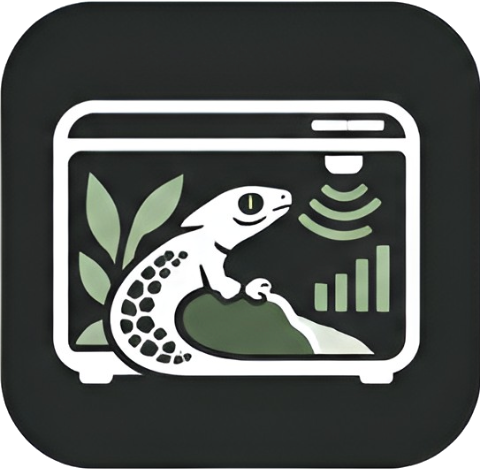
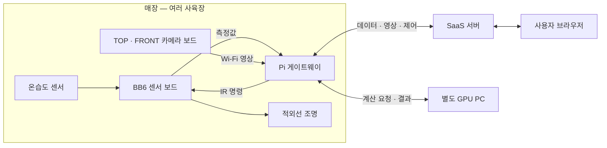

# EasyRep

**여러 매장의 사육장 센서·카메라·적외선 조명을 한곳에서 확인하고 관리합니다.**

매장의 Raspberry Pi가 장치 데이터를 모으고, SaaS 서버가 웹 화면으로 제공합니다. 이 저장소에서는 웹 프로그램, Pi 프로그램, 보드 펌웨어와 환경 모델 코드를 함께 관리합니다. 계산량이 큰 분석은 별도 GPU PC가 담당합니다.

[시작하기](#시작하기) · [연결 구조](#전체-연결-구조) · [코드 찾기](#프로젝트-구조) · [지원 범위](#현재-지원-범위) · [개발 참여](#개발에-참여하기)

## 주요 기능

- **센서 확인:** 사육장별 온도·습도와 수신 상태를 확인합니다.
- **카메라 보기:** 천장 TOP·전면 FRONT 영상을 Pi를 통해 웹으로 전달합니다.
- **IR 제어:** 야간 촬영용 적외선 조명의 켜기·끄기 요청과 장치 응답을 처리합니다.
- **환경 분석:** 센서 사이의 공간 온도를 추정하고, 별도 MLP 모델로 온습도 변화를 예측하는 코드를 제공합니다.
- **여러 매장 운영:** 같은 소스를 사용하면서 매장·사육장·장치 ID와 연결 정보를 설정으로 구분합니다.

기능마다 준비 상태가 다릅니다. 특히 환경 MLP의 최종 학습 파일은 아직 포함되지 않았으므로 [현재 지원 범위](#현재-지원-범위)를 먼저 확인하세요.

## 시작하기

### 화면을 사용하는 분

관리자가 제공한 EasyRep 주소에 로그인한 뒤 담당 매장과 사육장을 선택합니다. 센서값과 카메라의 **최근 갱신 상태**를 확인하고, IR 제어는 요청 결과와 실제 조명 상태를 함께 확인합니다. 계정·장치 등록·접속 키는 설치 관리자가 설정합니다.

소스 코드 설치는 화면을 이용하는 데 필요하지 않습니다. 개발 중인 화면과 운영 화면은 버전이 다를 수 있습니다.

### 설치하거나 코드를 수정하는 분

맡은 부분 하나부터 시작하세요. 각 문서에서 준비물, 실행 위치, 명령과 확인 결과를 안내합니다.

| 하려는 일 | 시작할 문서 | 먼저 확인할 결과 |
|---|---|---|
| 장치 없이 Pi 코드 실행 준비 | [Gateway 시작 안내](gateway/README.md#3-장치-없이-코드부터-확인하기) | 예제 설정 검사에서 `"valid": true` |
| 새 매장 Pi와 장치 설치 | [새 매장 설치 안내](gateway/docs/operations/new-store-setup.md) | Pi 연결 확인 → 장치 설치 후 센서·영상·응답 확인 |
| 웹 화면 수정 | [웹 안내](web/README.md) · [검사·빌드](web/README.md#검증) | 소스 검사와 변경한 화면의 빌드 |
| SaaS 서버 연동 | [브라우저 API](web/server/docs/web-api.md) · [Pi 카메라·IR API](gateway/docs/api/camera-ir-integration.md) | 양쪽의 인증·요청·응답 형식 |
| BB6 센서·IR 펌웨어 준비 | [BB6 안내](gateway/firmware/cage_node/README.md) | 공개 예제의 컴파일 결과 |
| ESP32-P4 카메라 펌웨어 준비 | [H.264 카메라 안내](gateway/firmware/camera_node/h264_node/README.md) | 지원 보드 확인과 빌드 결과 |
| 열역학·AI 모델 이해 | [모델 안내](models/README.md) | 입력·출력·필요한 파일·검증 범위 |

**펌웨어**는 보드 안에서 실행되는 프로그램입니다. **빌드**는 실행 파일을 만드는 과정이고, **업로드**는 만든 파일을 보드에 기록하는 과정입니다. 소스를 받거나 빌드하는 것만으로 설치된 장치의 프로그램이 바뀌지는 않습니다.

## 전체 연결 구조

매장마다 Pi 한 대가 여러 사육장을 맡습니다. Pi를 **Gateway(게이트웨이)**라고 부르는 이유는 장치와 서버 사이를 연결하기 때문입니다. **SaaS**는 브라우저로 이용하는 서버 프로그램을 뜻합니다.



BB6는 센서를 읽고 IR 신호를 출력합니다. DFR1172 카메라 보드는 영상을 만들어 Pi로 보냅니다. Pi·SaaS·GPU는 각각 설치하며, 매장별 주소와 인증정보를 설정으로 연결합니다. 장치와 프로그램의 상세한 책임은 [저장소 구조 안내](docs/repository-layout.md)에 정리했습니다.

## 프로젝트 구조

```text
EasyRep/
├── web/                 웹 화면과 Django SaaS 서버
├── gateway/             Pi·GPU 프로그램, 보드 펌웨어, 설정 예제와 시험
├── models/              모델 설명, 필요한 파일 목록과 검증 정보
├── behavior-recorder/   저장된 영상의 기록·행동 분석
├── docs/                저장소 구조와 설계 자료
└── SOURCE_SNAPSHOT.json 소스 출처와 통합 정보
```

| 찾는 내용 | 상세 문서 |
|---|---|
| Pi 내부 코드와 배포 절차 | [Gateway](gateway/README.md) |
| 센서 사이의 온도 추정·냉난방 부하 계산 | [열역학 모델](models/thermal-air/README.md) |
| 온습도 예측의 학습·추론·가중치 | [환경 MLP](models/environment-mlp/README.md) |
| 영상 기반 행동 분석 | [행동 분석](behavior-recorder/README.md) |
| 카메라 재연결과 브라우저 복구 처리 | [웹 카메라 구현](web/README.md#운영-카메라-재연결) |

## 현재 지원 범위

**2026년 11월 26일 소스 통합 기준**입니다. Pi·GPU 공통 소스는 HabitatOS **0.4.29**이며, 기존 패키지명과 통신 규격의 `HabitatOS` 이름을 유지합니다. 이 표는 배포·검증 기록의 범위를 설명하며 실시간 장치 상태를 표시하지 않습니다.

| 항목 | 포함된 내용과 확인 범위 |
|---|---|
| 센서·IR | BB6 펌웨어, Pi 제어 코드, SaaS 연동 코드와 시험을 포함합니다. 실제 제어에는 장치 설정·권한·배선이 필요합니다. |
| 카메라 2대 | FRONT는 P4의 H.264 압축·Pi 중계 구성입니다. TOP(`RGB-001`)은 촬영 시간 초과로 기존 MicroPython 방식에 복원한 기록이 있습니다. 두 보드의 펌웨어가 같다고 가정하지 않습니다. |
| 공간 온도 모델 | **20 × 20 × 30 cm** 사육장을 대상으로 합니다. 공간의 값은 센서로 보정한 추정값이며, 공간 전체의 정확도는 미검증입니다. |
| 환경 MLP | 학습·추론 코드와 파일 명세가 있습니다. **최종 가중치 3개와 학습 보고서는 GPU 데스크탑 원본 확인 대기**입니다. 실측 환경에 대한 예측 성능도 미검증입니다. |
| 펌프 | 실물 설치·제어 검증 대상에 포함하지 않았으며, 현재 비활성 설정을 유지합니다. |

**가중치**는 AI가 학습으로 얻은 숫자 파일입니다. MLP 명세의 `complete_inference_bundle=false`는 기존 학습 결과를 실행하는 데 필요한 파일이 아직 모두 준비되지 않았다는 뜻입니다.

## 개발에 참여하기

변경할 폴더의 README에서 실행 환경을 준비하고, 해당 범위의 시험을 실행한 뒤 Pull Request에 변경 이유와 검증 결과를 적어 주세요. 통신 형식을 바꾸면 Pi와 SaaS 양쪽이 같은 데이터를 이해하는지도 확인합니다.

Python의 **가상환경**은 프로젝트별 라이브러리를 따로 보관하는 폴더입니다. **`gateway/`와 `web/server/`는 반드시 별도 가상환경을 사용합니다.** 두 프로젝트에는 이름이 같은 서로 다른 `habitat` 패키지가 있습니다.

| 변경 대상 | 검증 안내 |
|---|---|
| Pi 프로그램·연동 규격 | [Gateway 설정 검사와 자동 시험](gateway/README.md#3-장치-없이-코드부터-확인하기) |
| 웹 화면·영상 재생 | [웹 검사·빌드](web/README.md#검증) · [카메라 복구 시험](web/README.md#운영-카메라-재연결) |
| 보드 펌웨어 | [BB6 빌드](gateway/firmware/cage_node/README.md) · [P4 빌드](gateway/firmware/camera_node/h264_node/README.md) |

문제를 제보할 때는 [Issues](https://github.com/BbangYi/EasyRep/issues)에 사용한 버전, 대상 구성요소, 재현 순서, 기대한 결과와 실제 결과를 적어 주세요. 센서·영상 문제는 장치 ID와 발생 시각을 함께 적으면 대조하기 쉽습니다. 암호·토큰·개인 키를 제거한 로그만 첨부합니다.

## 설정과 자료 보관

저장소에는 공개 설정 예제를 둡니다. 실제 Wi-Fi·MQTT 암호, 영상·IR 접속 키, 운영 DB와 촬영 영상은 설치 환경에 별도로 보관합니다. 소스 출처와 선별 범위는 [SOURCE_SNAPSHOT.json](SOURCE_SNAPSHOT.json)에 기록했습니다.

과거 운영 문서는 해당 날짜의 기록입니다. 일부 보고서·첨부 자료는 공개본에 포함되지 않았습니다. [초기 설계도](docs/EasyRep_민우파트_설계초안.drawio)는 2026년 10월 22일의 설계 초안입니다. 새 매장에서는 실제 센서값·영상·IR 응답을 각각 확인해야 합니다.

저장소 전체에 적용할 공통 라이선스 파일은 아직 없습니다. 포함된 외부 코드·모델·이미지의 출처와 라이선스 표기는 해당 구성요소의 문서를 확인하세요.
