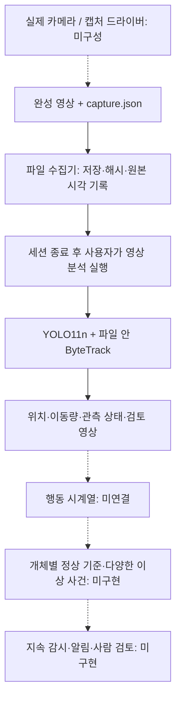

# AI 파이프라인 검증

**후속 구현, 2026-10-18:** 이 문서 작성 이후 [관찰 실험실](README.md)을 구현했습니다. 실제 학습 사진·박스 비교, 영상 분석·검토, 확정 파일 자동 수신, 개인별 정상 기록 비교·보류·평가 집계가 연결되었습니다. 공개 다른 종 영상의 실제 검출 실패도 화면에서 재생할 수 있습니다. 아래의 초기 점검 표와 누락 목록은 구현 전 시점의 기록입니다. 실제 카메라 현장 성능과 이상탐지 성능은 여전히 미검증입니다.

## 먼저 읽을 내용 — 자료·카메라·이상탐지 점검, 2026-10-18

**현재 확보한 것은 크레스티드 게코 사진 검출기와 저장 영상의 파일 단위 분석 기능입니다. 실제 카메라를 연결해 지속적으로 잘 탐지한다는 증거와, 실제 행동 이상을 탐지하는 학습 모델은 아직 없습니다.** 아래는 현재 코드·설정·학습 산출물과 원문 자료를 대조한 점검입니다. 새로운 학습이나 현장 배포 결과가 아닙니다.

자료가 날짜별 JSON에 흩어져 있어 현재 기능을 알아보기 어려웠습니다. 다음 순서로 확인할 수 있습니다.

- [무엇으로 만들었나: 자료와 실제 사용 여부](#evidence-sources)
- [실제 학습 사진 64장: 원본·저자·라이선스·라벨](#photo-catalog)
- [카메라 연속 감시: 구현된 것과 빠진 연결](#camera-audit)
- [여러 종류의 이상을 어떻게 구분할 것인가](#anomaly-design)
- [실제 사용까지의 구현 순서와 통과 기준](#field-gates)
- [기존 GPU 실험 상세](#training-history)

### 지금 확인된 수치

| 질문 | 확인 결과 | 직접 확인할 기록 |
| --- | --- | --- |
| 실제 학습용 자료는? | 공개 사진 64장 중 학습 42장: 게코 33장 + 게코 없는 장면 9장. 나머지 개발 검증 12장·시험 10장 | [dataset.json](data/datasets/crested-commons-v2r1/dataset.json) |
| 사람이 검수한 정답인가? | 64장 모두 AI 검토. 사람·전문가 검수 0장 | [검토·제외 기록](data/crested-reviewed-20261018/annotation-decisions.json) |
| 실제 학습은 실행했나? | 첫 모델에 이어 추가 5조건을 집 RTX 3060 Ti에서 실행 | [실행별 환경·회차·가중치 해시](data/vision-improvement-verification-20261018.json) |
| 더 좋은 모델을 확보했나? | 일부 사진의 오검출은 줄었지만 다른 사진의 누락이 증가. 운영 모델 승격 없음 | [1차 판단](data/research-20261018/round1-assessment.json), [후속 선택: baseline](data/gpu-jobs/crested-commons-v2-warm-01/result/selection.json) |
| 실제 게코 영상으로 연속 추적을 검증했나? | 이 작업에서 확보·평가한 실제 행동 영상 없음. 영상 연결 검사는 2초 합성 색상 막대 | [영상 검사 summary.json](data/crested-seed-video-interface-v3/summary.json) |
| 현재 카메라가 연결되어 있나? | 저장된 Pi 템플릿은 `connection=unconfigured`, 모델·fps 미지정. 이번 점검에서는 하드웨어 연결을 확인하지 않음 | [Pi 설정](examples/config.pi.crested-gecko.json) |
| 실제 이상 행동 학습량은? | 검토된 실제 이상 사건 0건. 새 검출기의 행동 분류·이상탐지는 `not_performed` | [영상 추론 코드](behavior_recorder/vision_video.py), [과거 합성 통계 모델](data/ai-demo-v2/model-cli.json) |

42장으로 학습한 것은 추가 비교 후보들입니다. 비교 기준으로 유지한 첫 모델은 이전 사진 27장으로 학습했습니다. “64장 데이터 세트 확보”, “42장으로 후보 학습”, “기존 기준 모델 유지”는 서로 다른 사실이며, 현재 자동으로 연결된 운영 모델은 없습니다.

### 무엇으로 만들었나: 자료와 실제 사용 여부

**실제로 사용한 모델·데이터·방법**

| 자료 | 이 프로젝트에서의 사용 | 해석 범위와 한계 |
| --- | --- | --- |
| [Ultralytics YOLO11 공식 문서](https://docs.ultralytics.com/models/yolo11/) / [공식 yolo11n.pt](https://github.com/ultralytics/assets/releases/download/v8.3.0/yolo11n.pt) | COCO 사전학습 검출기를 `crested_gecko` 단일 클래스에 추가 학습. 입력 640px, batch 4 | 게코 위치 박스를 찾는 모델. 자세·섭식·질병 모델이 아님. 공식 문서는 YOLO11 전용 정식 연구 논문을 발행하지 않았다고 명시 |
| Wikimedia Commons [크레스티드 게코](https://commons.wikimedia.org/wiki/Category:Correlophus_ciliatus), [Terrariums](https://commons.wikimedia.org/wiki/Category:Terrariums) | 최종 48장 게코 사진 + 16장 음성 사진. 음성은 식물·이끼·다른 파충류 등 대상 종이 없는 사진 | 사육장 연속 영상이 아님. 사진별 원문·저작자·사용 조건은 아래 64장 목록에 연결 |
| [ByteTrack 원 논문](https://arxiv.org/abs/2110.06864) | Ultralytics의 `bytetrack.yaml` 구현으로 같은 파일 안 검출 박스를 연결 | 논문의 사람·도로 추적 벤치마크 성능을 게코 성능으로 사용할 수 없음. 생물 개체 식별이나 행동 분류를 학습한 것이 아님 |
| [Ultralytics 추가 학습 안내](https://docs.ultralytics.com/guides/finetuning-guide), [학습 데이터 안내](https://docs.ultralytics.com/yolov5/tutorials/tips-for-best-training-results) | 학습률을 직접 제어하는 AdamW, 층 고정 비교, 배경 음성, 라벨 점검을 실험 설계에 참고 | 현재 첫 문서는 YOLO26, 두 번째는 YOLOv5 문서. 일반 원칙을 참고하고 실제 YOLO11 동작은 설치 코드·실행 기록으로 확인. 문서의 설정을 그대로 재현한 실험이 아님 |
| 자체 `median_mad_max_v1` | 화면 변화량의 정상 중앙값·MAD와 별도 보정 구간으로 이탈 점수 계산 | [analysis_features.py](behavior_recorder/analysis_features.py), [anomaly.py](behavior_recorder/anomaly.py). 64×48 화면 변화 특징이며 YOLO 관측과 연결되지 않은 별도 합성 시험 기준선 |

가중치와 환경은 논문 인용과 별개로 재현에 필요합니다. [초기 가중치 출처·SHA-256](data/weights/yolo11n.source.json), [첫 게코 모델 카드](data/gpu-jobs/crested-commons-seed-01/result/model/model.json), [3조건 설정](examples/vision.experiment-v2.json), [후속 2조건 설정](examples/vision.experiment-warm.json)에 보존했습니다. 실제 GPU 환경은 Python 3.12.10 / PyTorch 2.8.0+cu128 / Ultralytics 8.4.177입니다. `best.pt`는 숫자로 된 학습 가중치이고, 모델 카드는 어떤 데이터·설정으로 생성됐는지 설명하는 기록입니다.

**관련 연구이지만 현재 모델에 학습·통합하지 않은 자료**

| 정확한 자료 | 확인한 내용 | 우리 작업에 적용할 부분 / 아직 하지 않은 일 |
| --- | --- | --- |
| Pacoń 등, *Modelling behavior of Crested gecko (Correlophus ciliatus) using classification algorithms*, Applied Animal Behaviour Science 281, 106436. [DOI](https://doi.org/10.1016/j.applanim.2024.106436), [저자 공개 원고](https://www.researchgate.net/publication/385526079_Modelling_Behavior_of_Crested_gecko_Correlophus_ciliatus_using_Classification_Algorithms) | 20개체, 관찰 2,200건, 12특징, DT·GB·XGBoost 비교. 시간·온도·관찰 행동 등을 사용. 야간 IR 카메라 관찰을 포함하지만 영상에서 이상을 자동 검출한 모델은 아님 | 크레스티드 게코의 행동 항목·환경 맥락 설계에 참고. 원자료·가중치는 이번 작업에서 확보하지 않았음. 본문을 확인한 것은 저자가 올린 원고이며 출판사 본문 요청은 403 |
| Eisenberg & Shein-Idelson, *ReptiLearn*, PLOS Biology (2024). [논문](https://journals.plos.org/plosbiology/article?id=10.1371/journal.pbio.3002411), [공식 코드](https://github.com/EvolutionaryNeuralCodingLab/reptiLearn) | 비어디드 드래곤 사육장에서 장기간 카메라·온도·행동 처리와 장치 제어를 연결한 시스템 | 지속 수집·시각 동기화·분리된 영상 처리 구조의 참고. 크레스티드 전용 이상탐지 성능은 제공하지 않음. 우리 수집기와 통합하지 않았음 |
| Mathis 등, *DeepLabCut*, Nature Neuroscience (2018). [논문](https://www.nature.com/articles/s41593-018-0209-y), [저자 연구실 소개](https://bethgelab.org/publication/2018_09_mathis/) | 사용자가 지정한 신체 지점의 자세 추정 | 머리·몸통·사지 등 자세 정보가 필요한 단계에서 검토. 해당 실험의 약 200개 라벨 프레임 사례는 게코 이상탐지에 200장이면 충분하다는 뜻이 아님. 현재 미통합 |
| Goodwin 등, *Simple Behavioral Analysis (SimBA)*, Nature Neuroscience (2024). [논문](https://www.nature.com/articles/s41593-024-01649-9), [공개 논문](https://pmc.ncbi.nlm.nih.gov/articles/PMC11268425/) | 행동 정의·라벨을 바탕으로 행동 분류와 설명 가능성을 다루는 플랫폼 | 행동 시작·종료 시각과 검토된 정답을 만드는 절차에 참고. 현재 게코 행동 분류기를 학습하지 않았음 |
| *Bearded Dragon Activity Recognition Pipeline* (2025 preprint). [원문](https://arxiv.org/html/2507.17987v1) | 비어디드 드래곤·램프·귀뚜라미를 포함한 1,200장 이미지와 행동 추론 사례 | 객체 검출에서 행동 판단으로 넘어가는 구조의 참고. 다른 종이며 검출 오류가 행동 판단을 제한. 데이터는 내려받거나 학습에 사용하지 않았음 |
| *SAWIT: A small-sized animal wild image dataset with annotations*. [논문](https://link.springer.com/article/10.1007/s11042-023-16673-3), [저자 저장소](https://github.com/dtnguyen0304/sawit) | 34,434장, 도마뱀을 포함한 7개 범주 박스 주석 | 작은 동물·복잡한 배경의 외부 평가 후보. 크레스티드 행동 이상 정답 데이터가 아님. 이번 학습 사용량 0장; 개별 데이터 조건·종·분할 검토가 먼저 필요 |

따라서 **“크레스티드 게코 연구가 없다”는 표현은 맞지 않습니다.** 관련 연구는 있습니다. 다만 이번에 확인한 자료가 즉시 쓸 수 있는 크레스티드 사육장 연속 영상·다양한 이상 사건 정답 세트를 제공한다는 근거는 확보하지 못했습니다. Roboflow 117장 후보도 내려받지 않았으며 학습량에 포함하지 않습니다.

### 카메라 연속 감시: 구현된 것과 빠진 연결

현재 경로는 아래와 같습니다. 점선은 아직 연결하지 않은 부분입니다.

| 점검 항목 | 현재 코드의 정확한 상태 | 실제 운영에 미치는 영향 |
| --- | --- | --- |
| 카메라 입력 | [core.py](behavior_recorder/core.py)는 `unconfigured` 또는 `finalized_file`만 허용. 실제 CSI/USB/RTSP 캡처 어댑터 없음 | Pi 설정 파일만으로 카메라 촬영이 시작되지 않음 |
| 파일 수집 | [cli.py의 record](behavior_recorder/cli.py)는 `.capture.json`을 감시하고 완성 파일을 가져옴. 1회 실행 시간은 최대 3,600초 | 수집 루프는 있으나 자동 추론·상시 서비스는 아님. `source_idle`은 새 파일 없음이며 카메라 단절 증명이 아님 |
| 추론 시작 | [source_video / infer_video](behavior_recorder/vision_video.py)는 파일 1개 또는 종료·중단된 세션의 clip 1개를 받음 | 녹화 중인 세션을 즉시 분석하는 연결이 없음. 파일 한도는 10분·1GiB이며 무한 스트림 입력이 아님 |
| 처리 속도 | [설정](examples/vision.tracking.json)의 `sample_fps=3`은 원본에서 추출하는 목표 표본 속도 | 촬영 fps 또는 실시간 처리 fps가 아님. 원본 프레임 시각에 따라 실제 간격이 더 길 수 있으며 GPU/Pi 지연·처리량은 미측정 |
| 추적 연속성 | 한 번의 `infer_video` 안에서는 `persist=True`. 새 호출은 YOLO/추적기를 새로 생성 | 파일 경계에서 track ID를 그대로 이어 쓸 수 없음. 설정한 개체 ID는 사용자의 단일 사육 개체 선언이며 외형 식별 결과가 아님 |
| 추적 시간 기준 | 설치된 ByteTrack의 `track_buffer=30`은 처리 프레임 수. 관측 이동 계산은 원본 PTS와 `max_gap_seconds=0.6` 사용 | 3fps일 때 30번 갱신은 약 10초로, 30fps 영상의 1초와 다름. 추적 유지·가림 후 재연결 기준을 실제 입력 속도에서 검증해야 함 |
| 여러 박스·가림 | 신뢰도 0.4 이상 박스가 정확히 1개이고 track ID가 있어야 `observed`. 여러 개면 판단 보류 | 반사나 배경 오검출만으로도 이동 계산이 중단될 수 있음. 관측 비율은 정답 검출률이 아니며 `observed`도 오검출일 수 있음 |
| 이동량 | 같은 ID의 가까운 시각끼리 중심점 이동을 화면 대각선 길이로 정규화. 한 번에 0.15 초과는 비정상 추적 점프로 처리 | cm/s·실제 3D 높이가 아님. 빠른 실제 이동도 이 기준에 걸릴 수 있으므로 점프·낙하 판정에 바로 쓰면 안 됨 |
| 구역 | 현재 `zones={}`. 설정하면 중심점이 사각 구역에 들어간 샘플 수 출력 | 먹이 섭취·물 마시기·체류 시간 모델이 아님. 사각 구역 방문만으로 섭식을 확정할 수 없음 |
| 영상 검증 | 실제 게코 영상 0건. 2초 합성 영상 5개 샘플 중 1개가 게코로 잘못 관측됨 | 영상 저장·타임스탬프·호출 연결만 확인. 야간·반사·가림·재연결·24시간 정확도는 미검증 |
| 실행 장비 | Windows는 이미지 학습을 확인했으나 영상에 필요한 FFmpeg/ffprobe가 당시 PATH에 없었음 | GPU 학습 성공과 Windows 영상 처리 성공은 다른 증거. Pi 장기 운전도 미검증 |

**실시간 확인 화면에도 최소한 서로 다른 세 시각이 필요합니다:** 마지막 촬영 시각, 마지막 분석 완료 시각, 마지막 신뢰 가능한 관측 시각. 오래된 정상 결과를 현재 결과처럼 표시하면 안 됩니다. 그 옆에 현재 모델 버전, 관측 불가 사유, 처리 대기 시간과 근거 영상을 보여 주는 구성이 필요합니다. 이 화면은 아직 구현하지 않았습니다.

### 여러 종류의 이상을 어떻게 구분할 것인가

아래는 **앞으로 구현할 설계안**입니다. 지금 탐지 가능한 항목 목록이 아닙니다. 카메라가 보내는 영상의 상태, 동물이 보이는 정도, 실제 행동 변화를 따로 기록해야 합니다.

| 감지하고 싶은 변화 | 필요한 관측·학습 | 판단을 멈춰야 하는 경우 | 우선순위 |
| --- | --- | --- | --- |
| 촬영·분석 중단 | 프레임 시각, 프로세스 상태, 파일·전송·큐 상태. 학습 모델보다 상태 검사부터 | 단순 정지 화면만으로 카메라 고장을 단정하지 않음 | 첫 단계 |
| 관측 가능성 저하 | 검출 신뢰도·가림 라벨·복수 박스·야간 노출·카메라 위치 변경 | 동물이 안 보이면 활동량 0이나 정상으로 기록하지 않음 | 첫 단계 |
| 평소보다 활동량 감소·증가 | 신뢰 가능한 구간의 이동·정지 시간, 개체별 시간대 기준, 온습도·급여·분무·청소 기록 | 관측 범위 부족, 입력 누락, 비교할 같은 시간대 기록 부족 | 첫 행동 목표 |
| 특정 위치 체류·이용 변화 | 원본 시각으로 계산한 구역별 체류 시간·방문 횟수, 고정된 카메라/구역 보정 | 카메라·내부 구조 변경, 가려진 구역의 시간을 임의로 채운 경우 | 첫 행동 목표 |
| 반복 이동 패턴 | 연속 경로·속도·방향 전환·반복 횟수와 사람이 확인한 사건 구간 | ID 전환, 반사, 추적 점프. 반복 자체를 스트레스 진단으로 단정하지 않음 | 후속 |
| 급여 구역 방문·섭식 변화 | 우선 방문만 관측. 실제 섭식은 입/머리 동작·먹이 변화·사람의 사건 라벨을 추가 | 먹이 그릇 주변에 있다는 이유만으로 먹었다고 처리하지 않음 | 방문 먼저, 섭식 후속 |
| 자세·균형·급격한 이동 변화 | 자세 지점 또는 분할, 충분한 시간 해상도, 행동별 시작/종료 정답 | 3fps 표본·박스 중심점만으로 낙하·경련·질병 확정 불가 | 별도 검증 후 |
| 환경 변화와 행동 변화 동반 | 시각이 맞는 센서·단위·교정 정보, 설정된 환경 기준과 행동 시계열 | 오래된 센서 값·시계 오차·설정 근거 없음. 환경 이탈과 원인 진단을 구분 | 센서 연결 후 |

기본 구성은 **관측 품질 검사 → 행동 특징 → 개체·시간대 정상 기준 → 지속 이탈 후보 → 근거 영상과 사람 검토**입니다. 특정 행동을 구분할 데이터가 생기면 자세 추정·행동 분류기를 추가합니다. 처음부터 하나의 거대한 모델이 모든 이상을 분류한다고 가정하지 않습니다.

현재 중앙값·MAD 코드는 정상 기준 비교의 출발점으로 재사용할 수 있습니다. 다만 입력을 화면 전체 변화량에서 검증된 개체 행동 특징으로 바꾸고, 시간대·환경 맥락을 분리하며, 서로 다른 촬영일로 임계값을 보정해야 합니다. 기존 합성 모델 파일을 그대로 게코 정상 모델로 사용할 수 없습니다.

알림 결과에는 종류, 시작·종료 시각, 비교 기준, 관측 가능 비율, 판단 보류 사유, 원본 clip/PTS, 모델 버전, 사람 검토 결과가 필요합니다. 예를 들어 `activity_deviation`은 평소 활동과 달랐다는 뜻이며 질병명이 아닙니다. 확인되지 않은 이상을 자동으로 정상 학습에 넣으면 이상이 기준에 흡수될 수 있으므로, 재학습 자료는 검토 후 승인된 버전으로 고정합니다.

### 실제 사용까지의 구현 순서와 통과 기준

**1. 수집·자동 추론을 먼저 연결합니다.** 초기 경로는 Pi에서 시각이 있는 짧은 원본 구간을 확정 저장하고, 집 GPU의 지속 실행 작업자가 자동 분석하는 방식이 기존 수집기를 가장 많이 재사용합니다. 카메라 종류에 맞는 캡처 모듈, 원본 시각 검증, 전송 재시도, 중복 처리 방지, 제한된 대기열, 장애 후 재개가 필요합니다. 10–30초 구간은 초기 설계 후보이지 현재 설정이나 성능 측정값이 아닙니다. 파일이 완성되기를 기다리는 시간이 있어 빠른 낙하 같은 즉시 알림에는 별도 스트림 경로가 필요합니다.

파일 분할 때문에 운동 경로가 끊기지 않도록 카메라별 작업자가 모델·추적 상태를 유지하되, 시간 간격·카메라 revision이 바뀌면 연결을 끊고 `unknown`으로 기록해야 합니다. 현재 종료 세션만 받는 인터페이스를 그대로 무한 반복 호출하는 것만으로 해결되지 않습니다. 집 PC가 잠들거나 Tailscale 연결이 끊기면 Pi는 저장을 계속하고 분석 지연을 명시해야 합니다. Pi에서 직접 추론할지는 모델 export 후 실제 발열·지연 측정으로 결정합니다.

**2. 카메라 영상으로 검출기를 다시 평가·학습합니다.** 주간/야간/IR, 원거리·몸 일부, 반사, 식물·이끼, 급여·분무·청소, 완전히 가려진 구간을 포함합니다. 처음에는 1,000–2,000장 정도를 검수하는 작업 예산을 잡을 수 있지만 이는 성능을 보장하는 최소량이 아닙니다. 한 영상의 인접 프레임을 반복해서 늘리는 것보다 촬영일·시야·조건의 다양성이 중요합니다. Ultralytics의 1,500장/클래스 권고도 보편적인 합격선이 아닙니다. 우선 사람 검수 평가 자료를 고정하고, 모델이 틀리거나 판단을 못한 구간을 다음 학습 자료로 추가합니다.

**3. 첫 개체의 평소 패턴을 만듭니다.** 초기 수집 일정은 2–4주를 제안합니다. 여러 날의 시간대·환경·급여 맥락을 비교하기 위한 일정이며, 이 기간만으로 정상 행동 전체나 이상탐지 성능이 확보되지는 않습니다. 정상 검토·보정·시험을 날짜별로 분리합니다. 다른 개체에도 쓸 모델은 개체·사육장까지 분리한 평가가 추가로 필요합니다. 행동은 정답 사건 수와 다양성으로 계산하고, 정상 영상이 길다고 이상 사건 정답이 생긴 것으로 계산하지 않습니다.

**4. 활동 변화·구역 이용 변화부터 사람이 검토하는 시범 운전을 합니다.** 경고 후보와 전후 원본을 쌓고 실제 변화·검출 오류·환경 변화·판단 불가로 검토합니다. 자연스럽게 기록된 사건과 전문가가 판단한 사례를 사용하며, 학습용 이상을 만들려고 동물에게 위해나 불필요한 자극을 주지 않습니다. 희귀 사건이 없으면 해당 유형의 재현율은 `N/A`이며 100%가 아닙니다.

| 검증 축 | 반드시 함께 보고할 값 | 초기 통과 조건 제안 — 아직 미달성 |
| --- | --- | --- |
| 지속 수집 | 예정 시간, 실제 수집 시간, 최대 누락, 재연결 시간, 디스크 사용량 | 24시간 점검 후 72시간 연속 운전. 끊김·재시작·저장 공간 부족·PC 절전을 숨기지 않고 기록·복구 |
| 자동 분석 | 원본 촬영부터 결과까지 지연 p50/p95, 최대 대기열 나이, 버린 프레임 수 | 수집보다 분석이 지속적으로 느려 대기열이 증가하지 않을 것. 구간 길이와 행동의 시간 규모에 맞춘 지연 한도 설정 |
| 검출 | 사람이 보인다고 확인한 구간의 검출 재현율, 대상 없는 구간의 오검출, 주간/야간별 결과 | 새 날짜·조건의 평가에서 기존 모델보다 누락이 늘지 않는지 확인. 전체 평균이 야간 실패를 가리지 않게 조건별 표시 |
| 추적·관측 | 관측 가능 시간, 판단 보류 시간, 추적 끊김/ID 전환, 구역·이동 오류 | 가림·복수 박스·입력 단절을 활동 0으로 채우지 않음. 촬영 누락과 검출 누락의 분모를 분리 |
| 행동 이상 | 유형별 실제 사건 수, 발견 사건 수, 탐지 지연, 정상 관측 시간당 오경보 사건, 중복 알림 | 새 독립 사건과 여러 날의 정상 기록으로 판정. 보류된 실제 이상도 누락 평가에 포함. 허용 오경보 예산은 시범 검토 후 고정 |
| 모델 교체 | 기존/후보 동일 조건 비교, 오류 사례, 모델·자료 버전, 되돌릴 가중치 | 검토·평가를 통과한 후보만 교체. 학습 실행 횟수나 사진 F1 하나만으로 운영 승격하지 않음 |

이번 점검에서 추가한 것은 자료 안내·코드와 기능의 대응·현장 검증 설계입니다. 실행 코드를 바꾸거나 카메라 운전·새 모델 성능을 검증한 것으로 계산하지 않습니다. 이전 67개 자동 검사는 프로그램 회귀 검사이며 생물학적 성능 증거가 아닙니다.

문서의 사진 목록 64건, 이미지·라벨 128개 파일 해시, 첫 모델과 후보 5개의 가중치 해시, 로컬 자료 링크를 확인했습니다. [이번 점검의 기계 판독 기록](data/research-20261018/evidence-audit.json). 외부 사진 주소는 보관 manifest와 일치함을 확인했으며 64개 웹페이지를 모두 새로 요청한 것은 아닙니다.

## 데이터 보강·비교 학습 — 2026-10-18

공개 자료 조사 후 **실제 사진 64장(게코 48장, 크레스티드 게코가 없는 장면 16장)**으로 비교 실험을 구성했습니다. [데이터 manifest](data/datasets/crested-commons-v2r1/dataset.json), [라벨 검토·제외 사유](data/crested-reviewed-20261018/annotation-decisions.json), [실험 기준과 연구 출처](data/research-20261018/protocol.json)를 보관했습니다. 16장에는 배경·식물·빈 사육장·다른 파충류가 포함됩니다. 모든 라벨은 AI 검토이며 전문가 정답이 아닙니다.

| 용도 | 게코 사진 | 음성 사진 | 합계 |
| --- | ---: | ---: | ---: |
| 학습 | 33 | 9 | 42 |
| 개발 검증 | 9 | 3 | 12 |
| 새 보류 시험 | 6 | 4 | 10 |

이전 시험 5장은 결과를 이미 확인했으므로 개발 검증으로 전환했습니다. 새 시험은 이전 자료와 저자 그룹·동일 픽셀이 겹치지 않는 10개 그룹입니다. 개체 독립성이나 모든 유사 크롭을 증명한 것은 아닙니다. [분할 감사 기록](data/research-20261018/data-audit.json). `crested-commons-v2`는 박스 경계 보정 전 준비본으로 학습에 사용하지 않았으며, 실제 학습에는 `v2r1`만 사용했습니다.

### 첫 비교: 공식 사전학습 모델에서 시작

RTX 3060 Ti에서 명시적 AdamW·학습률 0.0001, 전체 층 학습 또는 backbone 11개 모듈 고정을 비교했습니다. 각 80회 상한 중 실제 회차는 58/43/42회이며, 검증 기준 최적 회차는 각각 38/23/22회였습니다. 고정 조건은 시드 42와 43으로 비교했습니다. [실행·모델·평가 기록](data/gpu-jobs/crested-commons-v2-01/).

검증 F1으로 `low-lr-frozen-seed43`을 선택한 다음, 고정 신뢰도 0.4·IoU 0.5로 **같은 새 시험 10장**에서 기존 모델과 비교했습니다. 시험 결과로 후보를 선택하지 않았습니다.

| 새 시험 결과 | 기존 모델 | 선택 후보 |
| --- | ---: | ---: |
| 게코 정탐 / 실제 6개 | 5 | 5 |
| 게코 누락 | 1 | 1 |
| 오검출 박스 | 9 | 1 |
| 오검출이 발생한 음성 사진 / 4장 | 4 | 1 |
| F1 | 0.500 | 0.833 |

후보의 시험 사진 10장 전체를 [예측 이미지](data/crested-v2-test-review/)로 확인했습니다. 식물에 매달린 게코(`commons-11947985`)를 놓쳤고, 이끼(`commons-116709485`)를 게코로 오검출했습니다. 검토 이미지는 출처 사진에 기준·예측 박스를 추가한 결과이며 저자·라이선스는 `predictions.json`에 있습니다.

**보편적인 개선으로 채택하지 않았습니다.** 개발 검증 9개 게코의 누락이 1개에서 4개로 늘었고, 고정 시드 42/43 사이의 검증 F1도 0.455/0.625로 달랐습니다. [비교 판단 기록](data/research-20261018/round1-assessment.json), [비교 그림](data/research-20261018/photo-comparison.png). 단순히 학습 회차를 늘려 해결됐다는 증거는 없습니다.

추가 [신뢰도 진단](data/research-20261018/validation-threshold-diagnostic.json)은 개발 검증에서만 수행했습니다. 선택 후보는 신뢰도 0.05까지 낮춰도 기존 모델의 검증 재현율 8/9를 회복하지 못했습니다. 이 진단은 Mac CPU에서 낮은 신뢰도로 얻은 예측을 다시 필터링한 것으로, 원래 GPU 비교와 실행 조건이 다릅니다. 새 독립 시험 결과로 계산하지 않습니다.

### 후속 실험 원칙

[후속 실험 기준](data/research-20261018/warm-protocol.json)은 기존 게코 가중치에서 더 작은 학습률로 시작해 누락을 보존하면서 오검출을 줄이는 것입니다. 부모 모델의 그룹·이미지·픽셀 노출 이력을 자식 모델에 승계하고, 부모가 본 시험 자료를 다시 독립 시험으로 쓰지 못하도록 검사합니다. `--development-only` 실행은 이미 확인한 시험 자료를 읽어 평가하지 않으며, 개발 검증에서 기존 모델의 재현율을 유지한 후보만 선택합니다. 이후 새 독립 자료에서 확인하기 전에는 현장 모델로 채택하지 않습니다.

후속 두 조건도 GPU에서 실제 실행했습니다. 학습률 0.00001/0.00005, backbone 고정, 각각 21회 후 조기 종료했으며 두 조건 모두 최적 회차는 1회였습니다. [후속 실행 기록](data/gpu-jobs/crested-commons-v2-warm-01/result/job.json).

| 개발 검증 결과 / 동일 12장 | 기존 모델 | 0.00001 | 0.00005 |
| --- | ---: | ---: | ---: |
| 게코 정탐 / 9개 | 8 | 8 | 8 |
| 오검출 박스 | 15 | 20 | 16 |
| 게코 누락 | 1 | 1 | 1 |
| F1 | 0.500 | 0.432 | 0.485 |

선택기는 **기존 모델 유지**로 결정했습니다. 후속 실행의 `held_out_metrics`는 빈 객체이며 별도 시험 디렉터리를 생성하지 않았습니다. 총 5조건을 실행했지만 전반적으로 나은 운영 모델을 확보했다고 주장하지 않습니다. 첫 후보의 제한된 시험에서 본 오검출 감소와 개발 검증의 누락 증가를 함께 보존했습니다.

최종 코드 검사 **67개 통과**: [로그](data/research-20261018/final-tests.txt). 추가 검사는 중복 박스·음성 오검출 집계, 시험 결과로 후보 선택 거부, 비교 기준 일치, 재현율 유지 조건, 부모 모델의 노출 이력 승계·누출 차단을 포함합니다. 실제 GPU 실행은 두 작업의 로그와 가중치로 별도 확인했습니다. [최종 판단·해시 기록](data/vision-improvement-verification-20261018.json).

검출기 다음 단계는 실제 사육장 영상에서 관측 가능 시간·추적 끊김·오탐 이벤트를 확인하고, 개체별 정상 행동과 검토된 이상 사건으로 별도 모델을 학습하는 것입니다. 사진 검출 F1은 이상탐지 정확도나 시간당 오탐률이 아닙니다.

## 실제 사진 학습·평가 — 2026-10-14

집 Windows GPU에서 실제 크레스티드 게코 사진으로 첫 검출기를 추가 학습하고 보류 시험까지 완료했습니다. **현장 검증 전 초기 모델**입니다. 전체 이력은 [vision-seed-verification-20261014.json](data/vision-seed-verification-20261014.json)에 있습니다.

### 데이터와 학습

- Wikimedia Commons 실제 사진 40장 확보, 4장 제외, 36장에 AI가 경계 박스 생성·시각 검토. 학습 27장/8그룹, 검증 4장/4그룹, 시험 5장/4그룹입니다. 모든 라벨은 `review_method=assistant`이며 사람·전문가 검수는 없습니다.
- 저자 이름의 변형을 통합해 같은 저자는 한 split에만 넣었습니다. 원본 그룹·동일 픽셀·라벨 범위·해시를 검사했지만 개체의 독립성이나 모든 유사 크롭까지 증명하지는 못합니다. 빈 사육장 음성 이미지는 0장입니다.
- 출처별 저자·원본/다운로드 URL·라이선스·해시를 [데이터 manifest](data/datasets/crested-commons-v1/dataset.json)에 보존했습니다. 라이선스는 사진마다 다릅니다. [라벨 검토 기록](data/crested-commons-downloads-v2/annotation-review-v1.json)에 제외 사유를 남겼습니다.
- RTX 3060 Ti 8GB, Python 3.12.10, PyTorch 2.8.0+cu128, Ultralytics 8.4.177에서 공식 YOLO11n 추가 학습. 160px/1회 연결 검사와 별도 640px/batch 4 후보 학습을 실행했습니다. 최대 30회 중 **11회 실행 후 조기 종료**, 검증상 최적은 1회였습니다. 이후 회차의 검증 지표는 개선되지 않았습니다.
- [모델 카드와 best.pt](data/gpu-jobs/crested-commons-seed-01/result/model/), [실제 회차 기록](data/gpu-jobs/crested-commons-seed-01/result/model/fit/results.csv), [원격 실행 로그](data/gpu-jobs/crested-commons-seed-01/execution.log)를 회수했습니다. 학습 중 자동 절전만 일시 억제하고 종료 시 해제합니다.

### 보류 시험과 직접 확인한 실패

[시험 5장](data/gpu-jobs/crested-commons-seed-01/result/evaluation/evaluation.json)의 mAP50은 **0.8664**, mAP50–95는 **0.5547**입니다. 작은 양성 사진 집합과 AI 라벨에 대한 박스 검출 지표입니다. 일반적인 정확도, 시간당 오탐률, 행동·질병·이상탐지 성능으로 해석할 수 없습니다. 모델 카드의 `production_validated`, `behavior_classifier`, `anomaly_detector`는 모두 false입니다.

고정 신뢰도 0.4로 시험 5장 전체의 [예측과 기준 박스](data/crested-seed-test-review-v1/predictions.json)를 시각 확인했습니다. 초록은 AI 기준 라벨, 주황은 모델 예측입니다.

- `commons-24969987`: 작은 개체를 검출하지 못했습니다.
- `commons-106516112`: 실제 게코 외에 배경에도 추가 박스가 생겼습니다.
- `commons-81642744`: 게코 주변까지 너무 크게 포함한 박스가 나왔습니다.
- 나머지 2장에는 게코 위치에 박스가 나왔습니다. 위 5장 전체를 검토했으며 좋은 결과만 고르지 않았습니다.

시험 결과를 확인한 후 모델·학습 조건을 수정하지 않았습니다. 향후 개선에 이 실패 사례를 사용하면 기존 시험 집합을 개발 자료로 전환하고 새 독립 시험 집합을 확보해야 합니다.

### 영상 연결과 코드 검사

- 동일한 학습 가중치로 Mac에서 ByteTrack·원본 PTS 기록·검토 MP4·검토 큐 생성까지 실행했습니다. 입력은 **2초 색상 막대 합성 영상**이며 실제 동물 영상 성능 검증이 아닙니다.
- [영상 출력 v3](data/crested-seed-video-interface-v3/)는 5개 샘플을 640×544 검토 영상으로 저장했습니다. 작은 원본에서 문구가 잘리던 문제를 수정하고 실제 프레임을 확인했습니다. 고정 속도 미리보기 길이는 1.6667초이며 원본 2초와 다릅니다. 원본 프레임/PTS와 대응 시간을 JSONL에 별도로 보존합니다.
- 동물이 없는 이 합성 영상에서도 1개 샘플이 `observed`로 표시됐습니다. 이는 **오검출**이며 실제 행동 관측 수에 포함하지 않습니다. 현재 모델의 오탐 한계를 보여 줍니다.
- 최종 macOS 검사: **62개 통과**. [검사 로그](data/vision-tests-20261014-final.txt). Windows 환경 검사 21개 통과·1개 제외와 실제 GPU 학습 성공은 별도 증거입니다. 최신 사진 검토·영상 표시 변경은 Mac에서 검증했으며 Windows 영상 디코딩은 FFmpeg/ffprobe 미설치로 아직 확인하지 못했습니다.

### 남은 현장 검증

실제 사육장 영상, 야간/적외선 조건, 빈 사육장·반사·식물 같은 음성 예시, 개체/촬영일을 분리한 추적 평가가 필요합니다. 개체별 정상 행동 기준, 실제 이상 사건 라벨, 오탐 이벤트/시간·탐지 지연 검증은 아직 없습니다. Pi는 미래 파일 입력 설정만 준비했으며 카메라 수집·실기기 장기 운전은 미검증입니다. 기존 웹앱·운영 DB·장치 제어·배포에는 변경이 없습니다.

## 학습 전 환경 구성 기록 — 2026-10-14

크레스티드 게코 전용 검출기 학습·시험 평가·영상 추적 명령을 추가했습니다. 실행법은 [README](README.md#실제-영상-모델), 기계 판독 기록은 [vision-verification-20261014.json](data/vision-verification-20261014.json)입니다. 아래 10월 8일 통계 기준선 검증과 별도 구현입니다.

- macOS 전체 검사: **62개 통과**. 데이터 출처·검토·라벨·원본 그룹 분할, 파일 변조, Windows 파일명 충돌, 관측 불가 구간, 원본 PTS, 실패한 실행의 상태를 확인했습니다.
- 집 Windows PC: `DESKTOP-GMQFQTR`, **RTX 3060 Ti 8GB**, Python 3.12.10, PyTorch 2.8.0+cu128, Ultralytics 8.4.177. `C:\Users\HOME\HabitatOS\vision-20261014`의 독립 가상환경을 사용합니다.
- 실제 CUDA 장치 `cuda:0`에서 계산·역전파와 공식 YOLO11n 가중치의 추론·추적 호출을 확인했습니다. 입력은 빈 소프트웨어 검사 이미지이며, 동물 성능을 측정하지 않았습니다.
- Windows 검사: **21개 통과, 1개 제외**. FFmpeg/ffprobe가 PATH에 없어 영상 디코딩 검사는 제외했습니다. 학습용 이미지 처리에는 영향을 주지 않으며, Windows에서 영상 분석까지 하려면 FFmpeg 설치가 필요합니다.
- [Windows 실행 및 검사 기록](data/home-gpu-verification-20261014c/)과 [macOS 검사 로그](data/vision-tests-20261014.txt)를 보관했습니다. 초기 GPU 검사기는 추론 백엔드 대신 원본 CPU 복사본을 확인해 오판했습니다. 이를 수정한 `20261014b`, 최종 파일명 충돌 검사를 포함한 `20261014c` 결과를 구분해 보존했습니다.

이 환경 구성 시점에는 실제 학습 이미지 0장, 추가 학습 가중치 없음 상태였습니다. 이후 위 Commons 사진으로 학습·시험을 완료했습니다. 공개 117장 Roboflow 후보는 로그인이 필요해 이번 학습에 사용하지 않았습니다. 이 절의 [이전 JSON 기록](data/vision-verification-20261014.json)은 당시 상태로 보존했습니다. 모의 학습기 검사는 실행 연결 검사이며 실제 학습 성공 건수에 포함하지 않습니다.

## 기존 통계 기준선 검증 — 2026-10-08

macOS arm64, Python 3.12.14, FFmpeg 9.0.1 환경에서 검증했습니다. 추가 Python 패키지·GPU·카메라·네트워크를 사용하지 않았습니다.

## 구현과 실행

- 원본 영상에서 64×48 회색조 화면 변화량·변화 픽셀 비율·밝기 특징 추출
- 선택 센서의 시각·정확도·단위·quality·revision 검사와 결측 처리
- 사람의 `assessment`와 visibility/certainty를 이용한 정상 학습 구간 선택
- 정상 중앙값·MAD 학습과 별도 세션의 임계값 보정
- 설정/개체/카메라/revision/context/provenance 일치 검사
- 지속 이상 후보, 근거 특징·영상 구간, 판단 보류 사유 출력
- 세션·recording·원본 분할 중복 및 시간 역전 차단
- 독립 평가, 고정 화면 변화량 임계값 기준선 비교, 판단 보류·오탐·탐지 지연 보고

**40개 테스트 통과**, unittest 보고 시간 **2.856초**입니다. 수집기 기존 21개와 새 파이프라인 19개를 포함합니다. 테스트 로그는 [data/ai-test-results.txt](data/ai-test-results.txt)에 있습니다.

실제 CLI의 `features`, `train`, `infer`, `evaluate`를 실행했습니다. 함수 실행과 CLI의 특징 dataset ID·모델 내용이 일치했습니다. 추론은 학습 모델 파일을 수정하지 않습니다. 세션 이동 후 동일 dataset ID와 동일 추론 결과를 확인했습니다.

## 보관된 결과

- [모델 JSON](data/ai-demo-v2/model-cli.json)
- [추론 결과](data/ai-demo-v2/predictions-cli.json)
- [평가 보고서](data/ai-demo-v2/evaluation-cli.json)
- [기계 판독 검증 기록과 소스 해시](data/ai-verification.json)
- 모델 ID: `a58eac5ff873257887256e845a68c077084ab9c4aee7b6859d247c4383b92999`
- 알고리즘: `median_mad_max_v1`
- 상태: `synthetic_pipeline_only`, `production_validated=false`

6개 합성 영상은 각각 12초, 64×48, 4 fps입니다. 학습·보정·평가에 서로 다른 세션 2개씩, 각 24개의 1초 창을 사용했습니다. 실제 행동 관측은 **0건**입니다.

## 합성 평가에서 나온 값

| 항목 | 결과 |
|---|---:|
| 평가 창 | 24 |
| 합성 정상 / 합성 이상 창 | 16 / 8 |
| TP / FP / TN / FN | 7 / 1 / 15 / 1 |
| 생성된 지속 경고 | 2 |
| 정상 구간의 오탐 이벤트 | 1 |
| 합성 이상 episode 탐지 | 1개 중 1개 |
| 해당 episode 탐지 지연 | 2초 |
| 판단 보류 | 0 |

이 값은 개발자가 동작을 설계한 **사각형 영상 테스트**의 결과입니다. 실제 동물 탐지 정확도, 실제 오탐률, 스트레스/질병 분류 성능이 아닙니다. 정상 구간에서도 경고가 발생했으며 개선 완료 상태로 표현하지 않습니다.

보고서의 `false_alerts_per_reviewed_normal_hour=225`는 정상 관측 16초에서 오탐 1회를 시간 단위로 정규화한 값입니다. 실제 한 시간 운영 예측이 아닙니다. 표본이 작을 때 시간당 수치를 그대로 제품 성능으로 사용하면 안 됩니다.

개발 중 첫 합성 fixture는 화면 경계에서 사각형이 반대편으로 순간 이동하는 형태였습니다. 그 변화가 정상 보정에 포함되어 임계점이 커졌고 합성 이상을 놓쳤습니다. 의도한 연속 이동이 되도록 fixture 경계를 반사 이동으로 수정했습니다. 이 과정 자체도 독립적인 생물학적 성능 검증이 아니라 테스트 입력 설계 과정입니다. 초기 결과는 `data/ai-demo/`, 수정된 실행은 `data/ai-demo-v2/`에 구분해 보관했습니다.

## 중요한 회귀 검사

- 빈 데이터·미검토 데이터·부족한 보정 데이터는 모델을 생성하지 않음
- anomaly로 검토된 값은 정상 중앙값 학습에서 제외
- 보정 데이터가 학습 중앙값을 바꾸지 않음
- 같은 세션·연속 녹화·원본이 평가에 들어오면 거절
- 실제 데이터의 촬영시각을 모르면 시간순 학습/평가를 거절
- test 모델과 real 데이터, 다른 개체·설치·context·전처리를 혼합하지 않음
- 원본 재입력·겹친 창·손상된 특징/모델 fingerprint를 거절
- 가림·불완전 라벨·충돌 라벨을 정상으로 간주하지 않음
- 검은 화면, 표본 부족, 원본보다 높은 fps로 복제된 표본은 판단 보류
- 센서 결측·오래된 값·미래값·시계 오차·단위/revision 불일치 보존
- 직전 센서 오류를 건너뛰고 과거 정상값으로 채우지 않음
- 지속 경고 카운트는 결측·clip 변경·구간 간격에서 초기화
- 판단 보류된 이상 구간도 event recall 분모에 포함
- 출력 파일 덮어쓰기 거절, 모델·원본 데이터의 폴더 이동 후 동일 결과

## 미검증/미구현

Pi/Linux 실행, 실제 RGB 카메라·동물·센서의 성능, 실제 시계 동기화, 장기간 운전은 미검증입니다. 개체/행동 인식, 열화상 특징, 실시간 알림, 장치 제어, 자동 온라인 재학습은 구현하지 않았습니다. 운영 DB·서버·배포에는 변경이 없습니다.

다음 실장비 작업은 카메라 모델/연결 확인 후 10초 원본 구간의 시야·PTS·촬영시각·ROI·부하를 검증하는 것입니다. 이후 같은 개체의 여러 날짜 기록을 사람 검토와 함께 수집하고, 실데이터로 새 모델을 학습·평가합니다.

## 실제 사용한 사진 64장의 출처 목록

최종 `crested-commons-v2r1/dataset.json`에서 생성한 목록입니다. 사진 ID를 누르면 실제 모델 입력 이미지를, 라벨을 누르면 정규화 박스 좌표를, 원문을 누르면 저작자·촬영 정보가 있는 Commons 페이지를 확인할 수 있습니다. 모든 사진의 검토 방법은 **assistant**입니다. 음성은 **크레스티드 게코가 없는 장면**이며 다른 동물이 있을 수 있습니다. 공개 사진이므로 모두 무료 무조건 사용 자료라고 해석해서는 안 됩니다. 저작자와 사진별 라이선스를 함께 보존했습니다.

사진은 Commons 축소본이며, 다운로드 이후 학습 원본의 픽셀은 바꾸지 않았습니다. 라벨은 AI가 별도로 작성했고 아래 검토 이미지에는 박스와 문구를 덧붙였습니다. 정확한 변경·해시·다운로드 주소는 [manifest](data/datasets/crested-commons-v2r1/dataset.json)에 있습니다.

분할은 저자 그룹을 기준으로 겹침을 제한했습니다. 같은 개체 여부와 모든 유사 크롭의 독립성을 보장하지는 않습니다. 같은 촬영에서 나온 다른 사진은 이미지 개수만 늘고 독립 관측량은 적을 수 있습니다.

### 학습 42장

| 사진 | 대상 | 라벨 | 저자 | 사용 조건 | 원문 |
| --- | --- | --- | --- | --- | --- |
| [commons-110750899](data/datasets/crested-commons-v2r1/images/train/commons-110750899.jpg) | 게코 | [라벨](data/datasets/crested-commons-v2r1/labels/train/commons-110750899.txt) | Lennart Hudel | [CC BY 4.0](<https://creativecommons.org/licenses/by/4.0>) | [원문](<https://commons.wikimedia.org/wiki/File:Correlophus_ciliatus_33484989.jpg>) |
| [commons-110750874](data/datasets/crested-commons-v2r1/images/train/commons-110750874.jpg) | 게코 | [라벨](data/datasets/crested-commons-v2r1/labels/train/commons-110750874.txt) | Lennart Hudel | [CC BY 4.0](<https://creativecommons.org/licenses/by/4.0>) | [원문](<https://commons.wikimedia.org/wiki/File:Correlophus_ciliatus_33603685.jpg>) |
| [commons-110750866](data/datasets/crested-commons-v2r1/images/train/commons-110750866.jpg) | 게코 | [라벨](data/datasets/crested-commons-v2r1/labels/train/commons-110750866.txt) | Lennart Hudel | [CC BY 4.0](<https://creativecommons.org/licenses/by/4.0>) | [원문](<https://commons.wikimedia.org/wiki/File:Correlophus_ciliatus_33604286.jpg>) |
| [commons-110750859](data/datasets/crested-commons-v2r1/images/train/commons-110750859.jpg) | 게코 | [라벨](data/datasets/crested-commons-v2r1/labels/train/commons-110750859.txt) | Lennart Hudel | [CC BY 4.0](<https://creativecommons.org/licenses/by/4.0>) | [원문](<https://commons.wikimedia.org/wiki/File:Correlophus_ciliatus_33604770.jpg>) |
| [commons-110750825](data/datasets/crested-commons-v2r1/images/train/commons-110750825.jpg) | 게코 | [라벨](data/datasets/crested-commons-v2r1/labels/train/commons-110750825.txt) | Lennart Hudel | [CC BY 4.0](<https://creativecommons.org/licenses/by/4.0>) | [원문](<https://commons.wikimedia.org/wiki/File:Correlophus_ciliatus_33605230.jpg>) |
| [commons-110750849](data/datasets/crested-commons-v2r1/images/train/commons-110750849.jpg) | 게코 | [라벨](data/datasets/crested-commons-v2r1/labels/train/commons-110750849.txt) | Lennart Hudel | [CC BY 4.0](<https://creativecommons.org/licenses/by/4.0>) | [원문](<https://commons.wikimedia.org/wiki/File:Correlophus_ciliatus_33605448.jpg>) |
| [commons-110750815](data/datasets/crested-commons-v2r1/images/train/commons-110750815.jpg) | 게코 | [라벨](data/datasets/crested-commons-v2r1/labels/train/commons-110750815.txt) | Lennart Hudel | [CC BY 4.0](<https://creativecommons.org/licenses/by/4.0>) | [원문](<https://commons.wikimedia.org/wiki/File:Correlophus_ciliatus_33605620.jpg>) |
| [commons-110750806](data/datasets/crested-commons-v2r1/images/train/commons-110750806.jpg) | 게코 | [라벨](data/datasets/crested-commons-v2r1/labels/train/commons-110750806.txt) | Lennart Hudel | [CC BY 4.0](<https://creativecommons.org/licenses/by/4.0>) | [원문](<https://commons.wikimedia.org/wiki/File:Correlophus_ciliatus_33606417.jpg>) |
| [commons-110750801](data/datasets/crested-commons-v2r1/images/train/commons-110750801.jpg) | 게코 | [라벨](data/datasets/crested-commons-v2r1/labels/train/commons-110750801.txt) | Lennart Hudel | [CC BY 4.0](<https://creativecommons.org/licenses/by/4.0>) | [원문](<https://commons.wikimedia.org/wiki/File:Correlophus_ciliatus_33606516.jpg>) |
| [commons-110750914](data/datasets/crested-commons-v2r1/images/train/commons-110750914.jpg) | 게코 | [라벨](data/datasets/crested-commons-v2r1/labels/train/commons-110750914.txt) | Lennart Hudel | [CC BY 4.0](<https://creativecommons.org/licenses/by/4.0>) | [원문](<https://commons.wikimedia.org/wiki/File:Correlophus_ciliatus_33612285.jpg>) |
| [commons-110750884](data/datasets/crested-commons-v2r1/images/train/commons-110750884.jpg) | 게코 | [라벨](data/datasets/crested-commons-v2r1/labels/train/commons-110750884.txt) | Lennart Hudel | [CC BY 4.0](<https://creativecommons.org/licenses/by/4.0>) | [원문](<https://commons.wikimedia.org/wiki/File:Correlophus_ciliatus_34354132.jpg>) |
| [commons-62766339](data/datasets/crested-commons-v2r1/images/train/commons-62766339.jpg) | 게코 | [라벨](data/datasets/crested-commons-v2r1/labels/train/commons-62766339.txt) | User:SteveLagou | [CC BY-SA 3.0](<http://creativecommons.org/licenses/by-sa/3.0/>) | [원문](<https://commons.wikimedia.org/wiki/File:Crested_gecko_2.JPG>) |
| [commons-48389404](data/datasets/crested-commons-v2r1/images/train/commons-48389404.jpg) | 게코 | [라벨](data/datasets/crested-commons-v2r1/labels/train/commons-48389404.txt) | Michael McConville | [CC BY 4.0](<https://creativecommons.org/licenses/by/4.0>) | [원문](<https://commons.wikimedia.org/wiki/File:Crested_gecko_back.jpg>) |
| [commons-92576948](data/datasets/crested-commons-v2r1/images/train/commons-92576948.jpg) | 게코 | [라벨](data/datasets/crested-commons-v2r1/labels/train/commons-92576948.txt) | DigitalLem0n | [CC BY-SA 4.0](<https://creativecommons.org/licenses/by-sa/4.0>) | [원문](<https://commons.wikimedia.org/wiki/File:Crested_gecko_juvenile.jpg>) |
| [commons-48389287](data/datasets/crested-commons-v2r1/images/train/commons-48389287.jpg) | 게코 | [라벨](data/datasets/crested-commons-v2r1/labels/train/commons-48389287.txt) | Michael McConville | [CC BY 4.0](<https://creativecommons.org/licenses/by/4.0>) | [원문](<https://commons.wikimedia.org/wiki/File:Crested_gecko.jpg>) |
| [commons-504557](data/datasets/crested-commons-v2r1/images/train/commons-504557.png) | 게코 | [라벨](data/datasets/crested-commons-v2r1/labels/train/commons-504557.txt) | annakilljoy, moderator of geckoleo.com/forum | [Public domain](<https://commons.wikimedia.org/wiki/File:Gekkoninae_Rhacodactylus_ciliatus_orange.png>) | [원문](<https://commons.wikimedia.org/wiki/File:Gekkoninae_Rhacodactylus_ciliatus_orange.png>) |
| [commons-179655720](data/datasets/crested-commons-v2r1/images/train/commons-179655720.jpg) | 게코 | [라벨](data/datasets/crested-commons-v2r1/labels/train/commons-179655720.txt) | Dr.Zoidberg2186 | [CC BY 4.0](<https://creativecommons.org/licenses/by/4.0>) | [원문](<https://commons.wikimedia.org/wiki/File:Gekon_orz%C4%99siony,_Correlophus_ciliatus_Harlequin.jpg>) |
| [commons-179655710](data/datasets/crested-commons-v2r1/images/train/commons-179655710.jpg) | 게코 | [라벨](data/datasets/crested-commons-v2r1/labels/train/commons-179655710.txt) | Dr.Zoidberg2186 | [CC BY 4.0](<https://creativecommons.org/licenses/by/4.0>) | [원문](<https://commons.wikimedia.org/wiki/File:Gekon_orz%C4%99siony,_Correlophus_ciliatus.jpg>) |
| [commons-67318332](data/datasets/crested-commons-v2r1/images/train/commons-67318332.jpg) | 게코 | [라벨](data/datasets/crested-commons-v2r1/labels/train/commons-67318332.txt) | Jazium | [CC BY-SA 4.0](<https://creativecommons.org/licenses/by-sa/4.0>) | [원문](<https://commons.wikimedia.org/wiki/File:Lil_B_the_Crested_Gecko.jpg>) |
| [commons-194030566](data/datasets/crested-commons-v2r1/images/train/commons-194030566.jpg) | 게코 | [라벨](data/datasets/crested-commons-v2r1/labels/train/commons-194030566.txt) | Chris Game | [CC BY-SA 2.0](<https://creativecommons.org/licenses/by-sa/2.0>) | [원문](<https://commons.wikimedia.org/wiki/File:MG_5409_(6251451336).jpg>) |
| [commons-194030569](data/datasets/crested-commons-v2r1/images/train/commons-194030569.jpg) | 게코 | [라벨](data/datasets/crested-commons-v2r1/labels/train/commons-194030569.txt) | Chris Game | [CC BY-SA 2.0](<https://creativecommons.org/licenses/by-sa/2.0>) | [원문](<https://commons.wikimedia.org/wiki/File:MG_5410_(6250928523).jpg>) |
| [commons-194030563](data/datasets/crested-commons-v2r1/images/train/commons-194030563.jpg) | 게코 | [라벨](data/datasets/crested-commons-v2r1/labels/train/commons-194030563.txt) | Chris Game | [CC BY-SA 2.0](<https://creativecommons.org/licenses/by-sa/2.0>) | [원문](<https://commons.wikimedia.org/wiki/File:MG_5411_(6251458812).jpg>) |
| [commons-194030564](data/datasets/crested-commons-v2r1/images/train/commons-194030564.jpg) | 게코 | [라벨](data/datasets/crested-commons-v2r1/labels/train/commons-194030564.txt) | Chris Game | [CC BY-SA 2.0](<https://creativecommons.org/licenses/by-sa/2.0>) | [원문](<https://commons.wikimedia.org/wiki/File:MG_5420_(6251461356).jpg>) |
| [commons-194030560](data/datasets/crested-commons-v2r1/images/train/commons-194030560.jpg) | 게코 | [라벨](data/datasets/crested-commons-v2r1/labels/train/commons-194030560.txt) | Chris Game | [CC BY-SA 2.0](<https://creativecommons.org/licenses/by-sa/2.0>) | [원문](<https://commons.wikimedia.org/wiki/File:MG_5426_(6251465038).jpg>) |
| [commons-194030557](data/datasets/crested-commons-v2r1/images/train/commons-194030557.jpg) | 게코 | [라벨](data/datasets/crested-commons-v2r1/labels/train/commons-194030557.txt) | Chris Game | [CC BY-SA 2.0](<https://creativecommons.org/licenses/by-sa/2.0>) | [원문](<https://commons.wikimedia.org/wiki/File:MG_5434_(6250941689).jpg>) |
| [commons-194030556](data/datasets/crested-commons-v2r1/images/train/commons-194030556.jpg) | 게코 | [라벨](data/datasets/crested-commons-v2r1/labels/train/commons-194030556.txt) | Chris Game | [CC BY-SA 2.0](<https://creativecommons.org/licenses/by-sa/2.0>) | [원문](<https://commons.wikimedia.org/wiki/File:MG_5440_(6251471620).jpg>) |
| [commons-194030553](data/datasets/crested-commons-v2r1/images/train/commons-194030553.jpg) | 게코 | [라벨](data/datasets/crested-commons-v2r1/labels/train/commons-194030553.txt) | Chris Game | [CC BY-SA 2.0](<https://creativecommons.org/licenses/by-sa/2.0>) | [원문](<https://commons.wikimedia.org/wiki/File:MG_5452_(6251475960).jpg>) |
| [commons-110909589](data/datasets/crested-commons-v2r1/images/train/commons-110909589.jpg) | 게코 | [라벨](data/datasets/crested-commons-v2r1/labels/train/commons-110909589.txt) | Lennart Hudel | [CC BY 4.0](<https://creativecommons.org/licenses/by/4.0>) | [원문](<https://commons.wikimedia.org/wiki/File:Crested_gecko_-_1.jpg>) |
| [commons-62766340](data/datasets/crested-commons-v2r1/images/train/commons-62766340.jpg) | 게코 | [라벨](data/datasets/crested-commons-v2r1/labels/train/commons-62766340.txt) | User:SteveLagou | [CC BY-SA 3.0](<http://creativecommons.org/licenses/by-sa/3.0/>) | [원문](<https://commons.wikimedia.org/wiki/File:Crested_new_born.jpg>) |
| [commons-504560](data/datasets/crested-commons-v2r1/images/train/commons-504560.png) | 게코 | [라벨](data/datasets/crested-commons-v2r1/labels/train/commons-504560.txt) | annakilljoy, moderator of geckoleo.com/forum | [Public domain](<https://commons.wikimedia.org/wiki/File:Gekkoninae_Rhacodactylus_ciliatus_tete.png>) | [원문](<https://commons.wikimedia.org/wiki/File:Gekkoninae_Rhacodactylus_ciliatus_tete.png>) |
| [commons-51098503](data/datasets/crested-commons-v2r1/images/train/commons-51098503.jpg) | 게코 | [라벨](data/datasets/crested-commons-v2r1/labels/train/commons-51098503.txt) | Crocodoodle | [CC BY-SA 4.0](<https://creativecommons.org/licenses/by-sa/4.0>) | [원문](<https://commons.wikimedia.org/wiki/File:Tailless_Crested_Gecko.jpg>) |
| [commons-25276894](data/datasets/crested-commons-v2r1/images/train/commons-25276894.jpg) | 게코 | [라벨](data/datasets/crested-commons-v2r1/labels/train/commons-25276894.txt) | Gir2rocks | [CC BY-SA 3.0](<https://creativecommons.org/licenses/by-sa/3.0>) | [원문](<https://commons.wikimedia.org/wiki/File:The_gecko_deception.jpg>) |
| [commons-82909705](data/datasets/crested-commons-v2r1/images/train/commons-82909705.jpg) | 게코 | [라벨](data/datasets/crested-commons-v2r1/labels/train/commons-82909705.txt) | Leiem | [CC BY-SA 4.0](<https://creativecommons.org/licenses/by-sa/4.0>) | [원문](<https://commons.wikimedia.org/wiki/File:%E7%9D%AB%E8%A7%92%E5%AE%88%E5%AE%AB.jpg>) |
| [commons-82553393](data/datasets/crested-commons-v2r1/images/train/commons-82553393.jpg) | 음성 | [라벨](data/datasets/crested-commons-v2r1/labels/train/commons-82553393.txt) | Cande114 | [CC BY-SA 4.0](<https://creativecommons.org/licenses/by-sa/4.0>) | [원문](<https://commons.wikimedia.org/wiki/File:Casita_de_vidrio_.jpg>) |
| [commons-111204259](data/datasets/crested-commons-v2r1/images/train/commons-111204259.jpg) | 음성 | [라벨](data/datasets/crested-commons-v2r1/labels/train/commons-111204259.txt) | The Urban Botanist Images | [CC BY 2.0](<https://creativecommons.org/licenses/by/2.0>) | [원문](<https://commons.wikimedia.org/wiki/File:Christmas_Ecosystem_with_Lights.jpg>) |
| [commons-111204260](data/datasets/crested-commons-v2r1/images/train/commons-111204260.jpg) | 음성 | [라벨](data/datasets/crested-commons-v2r1/labels/train/commons-111204260.txt) | The Urban Botanist Images | [CC BY 2.0](<https://creativecommons.org/licenses/by/2.0>) | [원문](<https://commons.wikimedia.org/wiki/File:Christmas_Ecosystem.jpg>) |
| [commons-61818443](data/datasets/crested-commons-v2r1/images/train/commons-61818443.jpg) | 음성 | [라벨](data/datasets/crested-commons-v2r1/labels/train/commons-61818443.txt) | Connor Betts connorbetts | [CC0](<http://creativecommons.org/publicdomain/zero/1.0/deed.en>) | [원문](<https://commons.wikimedia.org/wiki/File:Connor_Betts_2017_(Unsplash).jpg>) |
| [commons-65185942](data/datasets/crested-commons-v2r1/images/train/commons-65185942.jpg) | 음성 | [라벨](data/datasets/crested-commons-v2r1/labels/train/commons-65185942.txt) | Christian von Faber-Castell | [CC BY 4.0](<https://creativecommons.org/licenses/by/4.0>) | [원문](<https://commons.wikimedia.org/wiki/File:EUBLEPHARIS-MACULARIUS_Leopard-Gecko_Leopardgecko_201705276003.jpg>) |
| [commons-21879550](data/datasets/crested-commons-v2r1/images/train/commons-21879550.jpg) | 음성 | [라벨](data/datasets/crested-commons-v2r1/labels/train/commons-21879550.txt) | Pogrebnoj-Alexandroff | [CC BY 3.0](<https://creativecommons.org/licenses/by/3.0>) | [원문](<https://commons.wikimedia.org/wiki/File:Exo-terrarium.JPG>) |
| [commons-66574383](data/datasets/crested-commons-v2r1/images/train/commons-66574383.jpg) | 음성 | [라벨](data/datasets/crested-commons-v2r1/labels/train/commons-66574383.txt) | Krizu | [CC BY-SA 4.0](<https://creativecommons.org/licenses/by-sa/4.0>) | [원문](<https://commons.wikimedia.org/wiki/File:Gecko_Phelsuma_klemmeri.jpg>) |
| [commons-6964318](data/datasets/crested-commons-v2r1/images/train/commons-6964318.jpg) | 음성 | [라벨](data/datasets/crested-commons-v2r1/labels/train/commons-6964318.txt) | Amigovip | [CC BY-SA 3.0](<https://creativecommons.org/licenses/by-sa/3.0>) | [원문](<https://commons.wikimedia.org/wiki/File:Iguana_iguana_in_terrarium.JPG>) |
| [commons-62059678](data/datasets/crested-commons-v2r1/images/train/commons-62059678.jpg) | 음성 | [라벨](data/datasets/crested-commons-v2r1/labels/train/commons-62059678.txt) | Scott Webb scottwebb | [CC0](<http://creativecommons.org/publicdomain/zero/1.0/deed.en>) | [원문](<https://commons.wikimedia.org/wiki/File:Inside_the_Terrarium_(Unsplash).jpg>) |

### 개발 검증 12장

| 사진 | 대상 | 라벨 | 저자 | 사용 조건 | 원문 |
| --- | --- | --- | --- | --- | --- |
| [commons-124977301](data/datasets/crested-commons-v2r1/images/val/commons-124977301.jpg) | 게코 | [라벨](data/datasets/crested-commons-v2r1/labels/val/commons-124977301.txt) | KKPCW（Kyu3） | [CC BY-SA 4.0](<https://creativecommons.org/licenses/by-sa/4.0>) | [원문](<https://commons.wikimedia.org/wiki/File:Correlophus_ciliatus_in_aquarium.jpg>) |
| [commons-105261097](data/datasets/crested-commons-v2r1/images/val/commons-105261097.jpg) | 게코 | [라벨](data/datasets/crested-commons-v2r1/labels/val/commons-105261097.txt) | Papa webo | [CC BY-SA 4.0](<https://creativecommons.org/licenses/by-sa/4.0>) | [원문](<https://commons.wikimedia.org/wiki/File:Correlophus_ciliatus_partial_pinstripe.jpg>) |
| [commons-98954010](data/datasets/crested-commons-v2r1/images/val/commons-98954010.jpg) | 게코 | [라벨](data/datasets/crested-commons-v2r1/labels/val/commons-98954010.txt) | CRUSHER | [CC BY-SA 4.0](<https://creativecommons.org/licenses/by-sa/4.0>) | [원문](<https://commons.wikimedia.org/wiki/File:Crested_gecko-mars.jpg>) |
| [commons-15416446](data/datasets/crested-commons-v2r1/images/val/commons-15416446.jpg) | 게코 | [라벨](data/datasets/crested-commons-v2r1/labels/val/commons-15416446.txt) | Guitarsandcars76 | [CC0](<http://creativecommons.org/publicdomain/zero/1.0/deed.en>) | [원문](<https://commons.wikimedia.org/wiki/File:Crusted_Gecko.jpg>) |
| [commons-16789737](data/datasets/crested-commons-v2r1/images/val/commons-16789737.jpg) | 게코 | [라벨](data/datasets/crested-commons-v2r1/labels/val/commons-16789737.txt) | Eveha | [CC BY-SA 3.0](<https://creativecommons.org/licenses/by-sa/3.0>) | [원문](<https://commons.wikimedia.org/wiki/File:Eveha%27s_crested_gecko.jpg>) |
| [commons-9870397](data/datasets/crested-commons-v2r1/images/val/commons-9870397.jpg) | 게코 | [라벨](data/datasets/crested-commons-v2r1/labels/val/commons-9870397.txt) | Margo226 | [Public domain](<https://commons.wikimedia.org/wiki/File:Gecko_(2010).jpg>) | [원문](<https://commons.wikimedia.org/wiki/File:Gecko_(2010).jpg>) |
| [commons-81642744](data/datasets/crested-commons-v2r1/images/val/commons-81642744.jpg) | 게코 | [라벨](data/datasets/crested-commons-v2r1/labels/val/commons-81642744.txt) | Fishy MP | [CC BY-SA 4.0](<https://creativecommons.org/licenses/by-sa/4.0>) | [원문](<https://commons.wikimedia.org/wiki/File:Geco_crestato.jpg>) |
| [commons-24969987](data/datasets/crested-commons-v2r1/images/val/commons-24969987.jpg) | 게코 | [라벨](data/datasets/crested-commons-v2r1/labels/val/commons-24969987.txt) | istolethetv from Hong Kong, China | [CC BY 2.0](<https://creativecommons.org/licenses/by/2.0>) | [원문](<https://commons.wikimedia.org/wiki/File:Little_guy_(3458280178).jpg>) |
| [commons-106516112](data/datasets/crested-commons-v2r1/images/val/commons-106516112.jpg) | 게코 | [라벨](data/datasets/crested-commons-v2r1/labels/val/commons-106516112.txt) | istolethetv | [CC BY 2.0](<https://creativecommons.org/licenses/by/2.0>) | [원문](<https://commons.wikimedia.org/wiki/File:Mellow_yellow_fellow_(3458245904).jpg>) |
| [commons-141566644](data/datasets/crested-commons-v2r1/images/val/commons-141566644.jpg) | 음성 | [라벨](data/datasets/crested-commons-v2r1/labels/val/commons-141566644.txt) | 3steph14 | [CC BY-SA 4.0](<https://creativecommons.org/licenses/by-sa/4.0>) | [원문](<https://commons.wikimedia.org/wiki/File:Empty_terrarium.jpg>) |
| [commons-17262669](data/datasets/crested-commons-v2r1/images/val/commons-17262669.jpg) | 음성 | [라벨](data/datasets/crested-commons-v2r1/labels/val/commons-17262669.txt) | Mexnatter | [CC BY-SA 3.0](<https://creativecommons.org/licenses/by-sa/3.0>) | [원문](<https://commons.wikimedia.org/wiki/File:Glasterrarium.jpg>) |
| [commons-113304301](data/datasets/crested-commons-v2r1/images/val/commons-113304301.jpg) | 음성 | [라벨](data/datasets/crested-commons-v2r1/labels/val/commons-113304301.txt) | Lugraff | [CC0](<http://creativecommons.org/publicdomain/zero/1.0/deed.en>) | [원문](<https://commons.wikimedia.org/wiki/File:Leopardgecko_Sunny.jpg>) |

### 시험 10장

| 사진 | 대상 | 라벨 | 저자 | 사용 조건 | 원문 |
| --- | --- | --- | --- | --- | --- |
| [commons-16775690](data/datasets/crested-commons-v2r1/images/test/commons-16775690.jpg) | 게코 | [라벨](data/datasets/crested-commons-v2r1/labels/test/commons-16775690.txt) | Nathouf from France | [CC BY 2.0](<https://creativecommons.org/licenses/by/2.0>) | [원문](<https://commons.wikimedia.org/wiki/File:Rhacodactylus_ciliatus_%22dalmatien%22.jpg>) |
| [commons-10687613](data/datasets/crested-commons-v2r1/images/test/commons-10687613.jpg) | 게코 | [라벨](data/datasets/crested-commons-v2r1/labels/test/commons-10687613.txt) | Hexasoft | [CC BY-SA 3.0](<https://creativecommons.org/licenses/by-sa/3.0>) | [원문](<https://commons.wikimedia.org/wiki/File:Rhacodactylus_ciliatus_male.jpg>) |
| [commons-16775634](data/datasets/crested-commons-v2r1/images/test/commons-16775634.jpg) | 게코 | [라벨](data/datasets/crested-commons-v2r1/labels/test/commons-16775634.txt) | Zaahir from Brooklin, Canada | [CC BY 2.0](<https://creativecommons.org/licenses/by/2.0>) | [원문](<https://commons.wikimedia.org/wiki/File:Rhacodactylus_ciliatus_on_a_bed.jpg>) |
| [commons-3641551](data/datasets/crested-commons-v2r1/images/test/commons-3641551.jpg) | 게코 | [라벨](data/datasets/crested-commons-v2r1/labels/test/commons-3641551.txt) | Dawson | [CC BY-SA 2.5](<https://creativecommons.org/licenses/by-sa/2.5>) | [원문](<https://commons.wikimedia.org/wiki/File:Rhacodactylus_ciliatus.jpg>) |
| [commons-11947985](data/datasets/crested-commons-v2r1/images/test/commons-11947985.jpg) | 게코 | [라벨](data/datasets/crested-commons-v2r1/labels/test/commons-11947985.txt) | Brian Gratwicke | [CC BY 2.0](<https://creativecommons.org/licenses/by/2.0>) | [원문](<https://commons.wikimedia.org/wiki/File:Rhacodactylus_ciliatus01.jpg>) |
| [commons-149187296](data/datasets/crested-commons-v2r1/images/test/commons-149187296.jpg) | 게코 | [라벨](data/datasets/crested-commons-v2r1/labels/test/commons-149187296.txt) | Vsnary | [CC0](<http://creativecommons.org/publicdomain/zero/1.0/deed.en>) | [원문](<https://commons.wikimedia.org/wiki/File:Super_Empty_Back_Crested_Gecko.jpg>) |
| [commons-70000083](data/datasets/crested-commons-v2r1/images/test/commons-70000083.jpg) | 음성 | [라벨](data/datasets/crested-commons-v2r1/labels/test/commons-70000083.txt) | Photograph by Mike Peel ( www.mikepeel.net ). | [CC BY-SA 4.0](<https://creativecommons.org/licenses/by-sa/4.0>) | [원문](<https://commons.wikimedia.org/wiki/File:Instituto_Butantan_2018_20.jpg>) |
| [commons-61822887](data/datasets/crested-commons-v2r1/images/test/commons-61822887.jpg) | 음성 | [라벨](data/datasets/crested-commons-v2r1/labels/test/commons-61822887.txt) | Jeff Sheldon ugmonk | [CC0](<http://creativecommons.org/publicdomain/zero/1.0/deed.en>) | [원문](<https://commons.wikimedia.org/wiki/File:Jeff_Sheldon_2014-11-18_(Unsplash_sVGH5ROWnl4).jpg>) |
| [commons-116709485](data/datasets/crested-commons-v2r1/images/test/commons-116709485.jpg) | 음성 | [라벨](data/datasets/crested-commons-v2r1/labels/test/commons-116709485.txt) | Ltee333 | [CC BY-SA 4.0](<https://creativecommons.org/licenses/by-sa/4.0>) | [원문](<https://commons.wikimedia.org/wiki/File:Moss_with_Container.jpg>) |
| [commons-197879385](data/datasets/crested-commons-v2r1/images/test/commons-197879385.jpg) | 음성 | [라벨](data/datasets/crested-commons-v2r1/labels/test/commons-197879385.txt) | Dileepkumardr | [CC0](<http://creativecommons.org/publicdomain/zero/1.0/deed.en>) | [원문](<https://commons.wikimedia.org/wiki/File:Nature_Aquarium_Aquascape.jpg>) |

### 시험 사진의 실제 예측을 보는 방법

후보 모델의 시험 사진 10장 전부입니다. 초록 박스는 AI 기준 라벨, 주황 박스는 예측입니다. **사람이 검수한 정답은 아닙니다.** 아래 묶음은 좋은 결과만 고른 것이 아닙니다. 개별 오버레이와 출처는 [예측 기록](data/crested-v2-test-review/predictions.json)에 있습니다.

- [사진 1–4 묶음](data/crested-v2-test-review/sheet-0.jpg)
- [사진 5–8 묶음](data/crested-v2-test-review/sheet-1.jpg)
- [사진 9–10 묶음](data/crested-v2-test-review/sheet-2.jpg)
- [누락 예: 식물에 매달린 게코](data/crested-v2-test-review/commons-11947985.png)
- [오검출 예: 이끼](data/crested-v2-test-review/commons-116709485.png)

