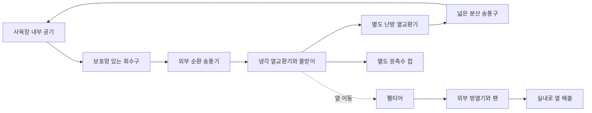

# 20×20×30cm 사육장 1대 — 냉각·난방·분무 설계안

작성: 2026-09-18. 상태: 제작 검토안 v0.3. 실물 제작·온도 유지·분무량 검증 전.

## 확정 요구와 설계 기준

사용자 확정: 사육장을 새로 구매한다. 외형 기준은 20×20×30cm다. 냉각·난방·분무·전원·구동회로·장착 후 보호구까지 완성 범위에 포함한다. 사육장 내부 수위센서와 누수센서는 기본 구성에서 제외한다. 분무 물통에는 물 보충 알림과 물 부족 시 분무 정지가 필요하다.

이 문서의 제안은 **외부 공조 모듈 + 별도 물통·펌프 + 상부 탈착 어댑터**다. 사육장 내부에는 송풍·흡입구, 센서, 노즐만 들어간다. 상용 사육장 후보는 Exo Terra PT2601 Nano Tall이며 제조사 외형은 20×20×30cm다. 상부 메시와 케이블·튜브 인입구를 이용하되 무거운 부품은 별도 받침 프레임이 지지한다. 실제 내부 치수와 상부 프레임 체결부는 외형 치수와 다르므로 실측하여 어댑터 도면을 만든다. [S1]

설치 장소의 온도, 목표 온도, 종·성장 단계는 아직 사용자가 알려주지 않았다. 아래 수치는 **빈 사육장 공학 시험 조건의 가정**이며 생물 사육 설정값이 아니다. 20×20×30cm의 사육 적합성도 이 문서로 확정하지 않는다.

| 조건 | 비교에 사용한 값 |
|---|---|
| 여름 시험 | 실내 32℃ / 내부 공기 26℃ |
| 겨울 시험 | 실내 18℃ / 내부 공기 24℃ |
| 한계 비교 | 여름 35℃ / 겨울 10℃ |
| 배치 | 직사광선 없음, Pi·전원·펌프는 사육장 밖 |
| 용적 | 외형으로 계산한 12L. 실제 유효 체적은 더 작음 |
| 전열 면적 | 단순 직육면체 0.32m². 실물 메시·어댑터 구조에 따라 달라짐 |

## 방식 선택

| 방식 | 판단 | 이유 |
|---|---|---|
| 환기팬만 사용 | 내부 발열 배출용 | 건조한 외기를 불어넣는 것만으로 외기보다 낮은 온도를 유지하지 못함 |
| 분무·증발을 주 냉각원으로 사용 | 채택하지 않음 | 냉각 요구 때문에 분무량이 늘어나며 온도와 수분 제어가 서로 묶임 |
| 외부 펠티어 공조 모듈 | 단일 12L 시험체의 우선 제작안 | 열부하가 작을 때 구현 가능한 구조. 방열·결로·바람을 함께 설계해야 함 |
| 외부 냉수·압축기 계통 | 고온 환경 또는 여러 사육장 확장 시 재비교 | 성능 여유가 필요할 때 대안. 첫 1대에서는 장치·배관·비용 증가 |
| 펠티어 극성 반전으로 냉난방 | 첫 제작에서는 채택하지 않음 | 양방향 전류제어 및 양면 결로·온도 제한이 추가됨 |
| 별도 저전압 저항 히터 | 난방 기본안 | 냉각부와 출력을 독립 제한하고 과열차단을 구성하기 쉬움 |

펠티어의 선택 기준은 소비전력이나 무부하 최대 온도차가 아니라 **실제 냉각면 온도 Tc, 고온면 온도 Th에서의 냉각능력 Qc**다. 외기로 버리는 열은 `Qh = Qc + 펠티어 입력전력`이다. [S2, S3]

## 냉각 용량과 공기 흐름

근사 열부하는 `Q = U·A·ΔT + ρcp·외기유량·ΔT + 내부발열 + 응축잠열`로 비교했다. 유효 U=3~6 W/(m²·K), 외기교환 10~60회/h, 응축량 1~5g/h, 내부발열 1~2W는 실측값이 아닌 민감도 가정이다. 사육에 적합한 환기량을 정한 값도 아니다. 메시를 열어 두거나 문을 열면 이 범위를 벗어날 수 있다.

| 시험 조건 | 추정 열부하 | 30% 여유 반영 |
|---|---:|---:|
| 여름 32 → 26℃ | 약 7.7~18.4W | 약 10.0~23.9W |
| 여름 35 → 26℃ | 약 10.7~24.8W | 약 13.9~32.3W |
| 겨울 18 → 24℃ | 약 8.7~21.4W | 약 11.3~27.8W |
| 겨울 10 → 24℃ | 약 16.7~38.6W | 약 21.7~50.2W |

겨울에는 정지한 펠티어를 통한 열손실 2~5W와 증발량 1~5g/h를 가정했다. 팬이 보태는 열은 난방 여유로 계산하지 않았다. 냉각·난방의 물 변화량은 서로 다른 운전 상태에 대한 가정이며 동시에 같은 물을 중복 계산한 것이 아니다. 계산 원본은 [thermal-sizing.py](thermal-sizing.py), 실행 결과는 [thermal-sizing.json](thermal-sizing.json)이다.

**1차 선정 목표:** Tc 약 20℃, Th 약 45℃에서 Qc 25W급을 검토한다. 32℃ 실내에 대한 가정상 목표이며, 35℃까지 유지한다고 보장하지 않는다. Same Sky CP60440은 40mm 각형·6A 계열의 데이터시트가 있는 비교 후보이다. 이 후보가 해당 동작점에서 25W를 충족하는지는 제조사 성능곡선과 조립체 시험으로 판정해야 한다. 단순히 이름이 비슷한 TEC1-12706을 동등품으로 확정하지 않는다. [S3, S4]

제조사의 CP60440 계산 예는 Th=50℃, Tc=10℃, 12V에서 약 3.77A, Qc 약 20.75W다. 이는 우리 동작점의 성능값이 아니라 **입력 약 45W와 실제 냉각 약 21W가 다르다는 사례**다. [S4]

설계 예에서 냉각 25W + 펠티어 전력 50W이면 외부 방열량은 75W다. 실내 32℃에서 고온면을 45℃ 이하로 잡으려면 접촉부를 포함한 열저항이 약 0.17K/W 이하여야 한다. 따라서 120mm급 팬을 갖는 방열기부터 비교하되, CPU 쿨러의 광고 TDP만으로 합격시키지 않는다. 회전수에 따른 실제 열저항·소음을 측정한다.



사육장 공기를 되돌리는 순환 경로와, 고온부에 실내 공기를 통과시키는 경로는 분리한다. 순환은 사육장의 기밀화를 의미하지 않는다. 기존 환기구의 기능을 유지하고, 환기량을 기록한 상태에서 냉각 성능을 평가한다.

공기 전달량도 병목이다. 20W를 공기 온도차 5℃로 옮기려면 실제 순환량 약 200L/min, 25W는 약 250L/min이 필요하다. 따라서 작은 저속 팬 하나만으로 25W 전체를 전달한다고 가정할 수 없다. **덕트·망·열교환기를 모두 장착한 상태에서 200~250L/min을 확보하는 송풍기**를 비교한다. 이것은 외기 환기량이 아니라 내부 재순환량이다.

상부의 넓은 분산판과 벽을 따라 흐르는 통로를 사용한다. 예를 들어 150cm² 출구에 250L/min이면 출구 평균 속도만 약 0.28m/s다. 동물이 머무는 위치의 직접 바람과 공간별 온도차를 측정해 적합성을 판단한다. 필요한 풍량에서 바람·소음이 과하면 펠티어를 더 크게 사는 것으로 해결되지 않는다. 환기 유지 조건에서 후면 단열, 더 넓은 열교환 면적 또는 설치 실내 냉방을 재검토한다.

26℃·상대습도 80%의 이슬점은 근사 22.3℃다. 20℃ 냉각면에는 결로가 예상되므로 차가운 핀 아래에 경사진 물받이를 두고 외부 컵으로 배수한다. 물이 사육장·팬 모터·회로로 흘러가지 않게 경로를 분리한다. 응축수는 분무 물통에 재사용하지 않는다. 냉각면 온도를 이슬점 위로 제한하는 모드에서는 냉각능력이 줄어들 수 있다. 결로 회피를 성능 보장의 대체로 쓰지 않는다.

## 난방 구조

외부 순환 덕트에 **12V·정격 30W 저항 히터 1개와 알루미늄 열분산판·핀**을 둔다. 정격 30W는 가정한 겨울 열부하에서 나온 설치 용량이다. 처음부터 30W를 연속 투입하지 않고, 빈 사육장에서 5W·10W·15W 등으로 올려 응답을 확인한다. 겨울 10℃ 시나리오의 상한 열부하는 이 용량을 초과한다.

발열 패드와 전기 접속부는 금속 격벽의 건조한 쪽, 공기와 접촉하는 핀은 덕트 쪽에 둔다. 접착제만으로 하중을 지지하지 않고 기계적으로 고정한다. 표면 히터와 금속판·별도 온도조절기를 결합하는 구조는 제조사 자료의 구성 원리를 참고했다. 특정 30W 상품의 검증을 마친 것은 아니다. [S5]

제어 입력은 사육장 공기 온도이며, 히터판·급기 온도는 출력 제한에 사용한다. 정격보다 중요한 것은 전달되는 공기와 접촉 가능한 표면의 온도다. 순환팬 정지·흡입 막힘에서 히터를 차단한다. ESP32 출력과 별개인 온도 제한기 및 직렬 열차단 소자를 둔다. 차단 온도는 히터판용과 사육장 공기용을 분리하며, 종·배치·재료가 정해지기 전에 생물용 한계값을 고정하지 않는다. 냉각과 난방은 동시에 켜지지 않게 한다.

## 전원과 구동 회로

첫 제작은 고출력 냉난방과 분무를 전원 분기로 나눈다. Pi는 기존 전용 전원을 사용한다.

| 분기 | 설계 기준 |
|---|---|
| 냉난방·로직 | 외장 12V 어댑터. 비교 모델 GST120A12-R7B: **12V·8.5A·102W**. 제품군 이름의 120을 120W로 읽지 않음 [S6] |
| 펠티어 | 전류 피드백이 있는 CC/CV 벅 구동부, 약 0~4.2A 제어 범위와 입력전력 60W 상한을 우선 검토. 실제 V-I 곡선에서 가능한 범위만 사용 |
| 난방 | 12V·30W → 약 2.5A. MOSFET으로 평균 출력 조절 |
| 팬 | 외부 방열팬과 내부 순환팬을 합쳐 초기 전력 예산 5W. 선정품이 초과하면 재계산 |
| ESP32·센서 | 12→5V 변환기. 로직 및 변환손실 예산 6W. 모듈 후보 D36V28F5의 정격은 입력·온도 조건에 따라 달라짐 [S7] |
| 분무 | 아래 MistKing 비교 구성에서는 별도 제조사 24V 어댑터 사용. 12V 전원에 직결하지 않음 [S8] |

정상 냉각 예산은 60+5+6=71W, 난방은 30+5+6=41W다. 두 출력을 동시에 켜면 101W로 102W 전원에 여유가 없으므로 **하드웨어 상호배제**가 전제다. 배선·퓨즈는 출력별 분리하고, 실제 전류 및 케이블 허용 전류에 맞춘다. 기존 30A 동봉 퓨즈를 그대로 적용하지 않는다. 12V 대전류 커넥터는 어댑터 지정 핀아웃과 접점 정격에 맞춘다.

펠티어는 MOSFET으로 공급전압을 그대로 잘라 인가하는 구동보다 필터된 DC 전류를 제어하는 구동을 우선한다. 전류 리플 목표는 5% 이하이며, 전원 리플 권고와 전류 리플 측정값을 혼동하지 않는다. 제조사의 권고와 TI CC/CV 참고 회로를 출발점으로 삼고, 보상·인덕터·전류센싱·기동 과도응답을 검토해야 한다. 이 문서는 그 구동기의 제작 완료 회로도가 아니다. [S9, S10]

```text
12V 어댑터
  ├─ 로직 분기 퓨즈 → 5V 벅 → ESP32 → 3.3V 센서
  ├─ 팬 분기 퓨즈 → 방열팬 / 순환팬 (회전 확인)
  └─ 독립 차단부·냉난방 상호배제
       ├─ TEC 분기 퓨즈 → CC/CV 구동부 → 펠티어
       └─ HEAT 분기 퓨즈 → 독립 온도차단 → 히터 → MOSFET → GND

24V 제조사 어댑터
  └─ 펌프 분기 퓨즈 → 독립 최대시간 차단부 → 펌프 → MOSFET → GND

ESP32 3.3V 신호 → 하드웨어 허용 로직 → 게이트 드라이버 → MOSFET 게이트
```

히터·펌프 구동의 출발 회로는 3.3V 논리입력 대응 게이트 드라이버(예: UCC27511), 10~12V 게이트 구동, 해당 전압에서 RDS(on)이 명시된 N채널 MOSFET이다. 펌프 분기는 80V급 소자를 비교하고, 게이트 직렬 저항·게이트-소스 풀다운·전원 디커플링을 둔다. 입력은 부팅 때 OFF가 되도록 풀다운한다. 24V 펌프의 역기전력은 모터 구성에 맞는 다이오드·TVS로 제한하며, 클램프 최대전압이 MOSFET 정격보다 낮도록 계산한다. 모터 보호 소자 정격·보드 열설계·퓨즈 시간특성까지 정해야 조립 가능한 회로도가 된다. [S11]

이 비절연 제어안에서는 12V·24V DC의 GND를 제어반 한 지점에서 연결하고 모터 전류가 센서 접지를 지나지 않도록 배선한다. Pi USB를 연결할 때 ESP32의 5V 공급과 USB VBUS가 중복되지 않도록 데이터 연결 방식을 정한다. 외부 어댑터의 AC 부분을 개조하지 않는다.

기존 게이트웨이 코드는 시뮬레이션 상태다. TEC 전류 제어, 팬 회전 확인, 수위 입력, 독립 차단 로직은 아직 실물 펌웨어에 구현되지 않았다. 기존 `fan` 액추에이터를 냉각기와 같은 것으로 표시하지 않는다.

## 분무와 물통

기본 유로는 **외부 물통 → 필터 → 펌프 → 튜브 → 역적하 억제 노즐 1개**다. 목표는 벽·잎에 작은 물방울을 공급하는 것이다. 12L 전체를 계속 안개로 채우는 운전을 기본으로 하지 않는다. 노즐은 위쪽 한 모서리에 두고 센서·흡입구·전자부에 직접 분사되지 않도록 각도를 잡는다.

우선 비교 구성은 **MistKing MKP-125-50 펌프 + Value L 노즐 1개 + 제조사 1/4인치 튜브·피팅·필터**다. 제조사는 이 펌프의 1~10노즐 사용과 Value L의 체크밸브 팁을 설명한다. 조합 근거가 있어서 선택한 시험 기준이며 최저가 구성이라는 뜻은 아니다. 1/4인치는 6.35mm이므로 기존 목록의 외경 6mm 튜브와 혼용하지 않는다. [S8]

더 작은 상용 비교품 Exo Terra Monsoon Nano는 제조사 설명에 2bar·5.6W와 초 단위 분무 설정이 있지만, ESP32 외부 명령을 직접 받을 수 있는 인터페이스는 확인되지 않았다. 따라서 제어 가능한 DIY 펌프와 동등품으로 취급하지 않는다. 분무 성능 비교 장치로는 사용할 수 있다. [S12]

물통은 뚜껑·통기구·세척 가능한 구조의 **약 1L**로 시작한다. 이것은 운영 일수를 보장하는 수량이 아니라 좁은 시험체에서 보충·세척·물량을 확인하기 위한 설계안이다. 제조사 권고에 맞춰 펌프 흡입구는 물통 출구보다 낮게, 물통 최고 수면은 노즐보다 낮게 둔다. 펌프는 방진패드가 있는 독립 받침에 고정하고 사육장 유리에 진동을 전달하지 않는다. [S8]

단일 사육장·단일 펌프이므로 별도 구역 선택용 NC 솔레노이드 밸브는 기본안에서 뺀다. 정지 후 잔류수량·사이펀 시험에서 문제가 생기면 제조사 압력해제 장치나 적합한 차단밸브를 추가한다. 체크밸브가 붙었다는 이유만으로 잔류 분무가 0이라고 가정하지 않는다.

분무 제어는 습도가 낮을 때 계속 켜는 방식 대신 **허용 시간대 + 교정한 1회 물량 + 1회 최대시간 + 누적 물량 상한**으로 구성한다. 분사 직후에는 관찰 시간을 두고 습도 변화만으로 바로 추가 분사하지 않는다. 빈 사육장 밖에서 1초·2초·3초 펄스를 각각 10회 받아 질량과 분사 지연·정지 후 물방울을 측정한다. 측정 전에는 초를 mL로 환산하지 않는다. 짧은 펄스가 안정되지 않으면 최소 안정 펄스에 맞는 노즐 또는 펌프를 선택해야 한다.

## 수위 알림: 물통에만 적용

기본안은 물통 안의 **두 지점 플로트 스위치**다. 예시로 1L 물통에서 약 200mL 잔량 위치는 보충 경고, 약 100mL는 분무 정지 지점으로 잡되, 실제 흡입구 높이·물통 기울임·펌프 요구 잔량에 맞춰 위치를 조정한다. 플로트는 연속 잔량계가 아니므로 화면에 임의의 잔량 %를 표시하지 않는다. [S13]

| 상태 | 표시·동작 |
|---|---|
| 두 지점 모두 물 있음 | 정상 |
| 위쪽만 물 없음 | 물 보충 필요 / 하한 이상에서는 예약 분무 허용 |
| 아래쪽 물 없음 | 물 부족 / 분무 차단 |
| 상하 상태 모순, 커넥터 분리 | 수위 확인 필요 / 분무 차단 |

스위치는 실물 방향을 확인하여 **해당 높이까지 물이 있을 때 접점 닫힘**, 물이 없거나 선이 끊기면 열림이 되게 설치한다. 물통 하한 입력은 펌프 허용 회로에도 연결한다. 플로트 접점으로 펌프 전류를 직접 끊지 않는다. 물을 보충한 뒤 상태가 안정되면 다음 예약부터 재개하며, 누락된 분무를 몰아서 실행하지 않는다. 단순 접점 방식은 고착·선간 단락까지 진단하지 못하므로 물통을 비우는 시험에서 두 단계 전환을 확인한다.

사육장 누수센서와 바닥 수위센서는 제외한다. 펌프·연결구 아래에는 물통 최대 물량을 받을 수 있는 수동 받침을 두고, 사육장에는 분무량에 맞는 탈착 물받이·바닥 관리 구조를 둔다. 냉각 응축수 컵은 따로 둔다. 전자 누수 감지를 생략해도 물이 흐를 곳은 필요하다.

## 장착하고 보호구를 씌우는 구조

1. 사육장 밖 별도 받침 프레임에 공조 모듈·펌프·전장함을 장착한다. 유리와 상부 메시에는 모듈 무게를 싣지 않는다.
2. 상부 탈착 어댑터로 공급·회수 덕트와 노즐을 연결한다. 유리 천공을 기본 제작 공정에 넣지 않는다. 보호망·탈출 방지 체결과 기존 환기 경로를 유지한다.
3. 내부 센서는 레일·브래킷으로 고정하고 선은 닫힌 채널에 넣는다. SHT31 보호구는 통풍을 유지하며 물방울만 막는다.
4. 조립·배선 확인 후 팬 그릴, 뜨거운 방열부 외부 커버, 내부 흡입·송풍 보호망, 케이블 덮개를 체결한다. 보호구의 간섭과 풍량 저하를 설치 상태에서 측정한다.
5. 전원 차단 후 커넥터·물 연결·덕트 어댑터를 분리하면 사육장 본체를 꺼내 청소할 수 있게 한다. 물·12V·24V·센서 커넥터는 서로 잘못 결합되지 않게 한다.

기존 온도센서 5개는 내부 공간 측정에 유지한다. 추가로 실내 온도·냉각판·고온 방열판·히터판용 온도센서 4개를 반영한다. 독립 과열 제한기의 센서는 이 공용 측정 버스만으로 대체하지 않는다.

## 제작 판단을 내리는 시험

| 시험 | 얻어야 하는 결과 |
|---|---|
| 열부하 식별 | 같은 환기 상태에서 알려진 소전력 히터로 정상상태 온도 상승 측정. `P/ΔT`로 유효 열손실 계수의 1차 추정. 일사·습윤 조건 별도 기록 |
| 건조 냉각 | 32℃ 외기 조건에서 내부 5점 온도, 공급·회수 온도, 고온면, 전력, 실제 순환량 기록. 가정한 목표와 비교 |
| 습윤 냉각 | 동일 조건에서 분무 후 응축량·배수·냉각능력 저하 기록. 응축컵 용량과 비우는 주기 산정 |
| 난방 | 18℃ 외기 조건에서 출력 단계별 응답·국소 고온·독립 차단 확인 |
| 정지 고장 | 팬 정지, 센서 분리, 통신 중단, 제어 출력 고정에서 허용 회로와 별도 차단 동작 확인 |
| 분무 | 반복 펄스별 질량, 정지 후 물방울, 최대 수면에서 사이펀 여부, 분무통 상·하한 확인 |
| 장착 상태 | 모든 보호구를 끼운 상태에서 풍량·소음·탈착·선 걸림·물이 흐르는 경로 확인 |

결과를 내지 못했을 때 변경할 요소도 정한다. 방열판 온도가 높으면 고온부 방열을 수정하고, 냉각판은 차갑지만 내부가 안 내려가면 냉각면 열교환·풍량·열부하를 수정한다. 열부하가 선정 냉각능력을 넘으면 단열 또는 냉각 방식·설치 실내 조건을 바꾼다. 소프트웨어 출력 한도를 무작정 높이지 않는다.

## 구매목록과의 관계

기존 506,530원은 이전에 조사한 부품 가격 합계다. 새 사육장·공조 모듈·보호구·물통 등 이 설계를 완성하는 총비용으로 사용하지 않는다. 냉각·난방은 완성 범위의 필수 항목으로 옮기고, 누수 감지 항목은 물통 2단 수위 감지로 바꾼다. 기존 6mm 튜브·노즐·체크밸브·45W 펌프·환기팬 후보는 위 설계의 채택품과 중복 또는 불일치할 수 있으므로 이전 가격 기록을 신규 발주 목록으로 그대로 사용하지 않는다.

완성 예산에는 사육장 본체, 냉각 조립체·구동부, 히터·독립 차단, 전원·배선, 분무 계통, 물통·수위, 기구·보호구, 추가 온도센서를 각각 포함해야 한다. 후보 브랜드의 해외 판매가를 국내 실구매가로 임의 환산하거나, 제작 치수와 정격이 없는 상태에서 확정 견적으로 표시하지 않는다. 정확한 구동회로 부품값·기판 레이아웃·체결 도면과 국내 견적은 아직 작성되지 않았다.

## 근거 자료

2026-09-18 조회. 제조사 자료는 기술 선택의 근거이며 실제 성능 시험이나 국내 결제가 확인을 대신하지 않는다.

- [S1 Exo Terra PT2601 Nano Tall](https://exo-terra.com/products/terrariums/natural-terrariums/natural-terrarium-nano-tall/) — 외형·메시·인입구.
- [S2 Laird Thermoelectric Handbook](https://lairdthermal.com/sites/default/files/fields/media.file.field_media_file/2022-12/Thermoelectric-Handbook-060222.pdf) — Tc·Th·Qc, 열부하·방열 구조.
- [S3 Same Sky: How to Select a Peltier Module](https://www.sameskydevices.com/blog/how-to-select-a-peltier-module) — 판 양면 온도차, 전류제어와 성능곡선.
- [S4 Same Sky Peltier Application Note](https://www.sameskydevices.com/catalog/resource/peltier-app-note.pdf) 및 [CP60440](https://jp.sameskydevices.com/product/thermal-management/peltier-devices/single-stage-peltier-modules/cp60440) — 후보 치수와 제조사 동작점 예. PDF 직접 열기는 접근 제한이 있어 검색 색인의 제조사 본문을 사용했다.
- [S5 Watlow Silicone Rubber Enclosure Heaters](https://www.watlow.com/en/products/heaters/air-heaters/silicone-rubber-enclosure-heaters) — 금속판·온도조절기 구성 원리.
- [S6 MEAN WELL GST120A 데이터시트](https://www.meanwell.com/Upload/PDF/GST120A/GST120A-SPEC.PDF) — 12V 모델 8.5A·102W.
- [S7 Pololu D36V28F5](https://www.pololu.com/product/3782) — 5V 변환기 비교 후보.
- [S8 MistKing Starter Pump](https://mistking.eu/Starter-Diaphragm-Misting-Pump.html), [Starter System](https://europe.mistking.com/Starter-Misting-System-v5.0.html), [Value L](https://mistking.eu/Value-L-Misting-Assembly.html) — 24V·1노즐 대응·1/4인치 계통·중력급수·잔류 적하.
- [S9 Ferrotec Power Supply Requirements](https://ferrotec.com.sg/product/thermo/technical_reference_guide/7/) 및 [Meerstetter FAQ](https://www.meerstetter.ch/customer-center/faq) — 리플과 DC 전류 구동.
- [S10 TI CC/CV Buck 설계](https://www.ti.com/lit/an/snva829/snva829.pdf) — 펠티어 전류 구동부 개발의 회로 참고.
- [S11 TI UCC27511](https://www.ti.com/product/UCC27511) — 3.3V 논리와 저측 MOSFET 게이트 구동의 참고 부품.
- [S12 Exo Terra Monsoon Nano 매뉴얼](https://exo-terra.com/wp-content/uploads/PT2479_Monsoon_Nano_EU.pdf) — 비교 장치의 펌프·분무 설정·운전 조건.
- [S13 Sensata Level Sensors & Switches](https://www.sensata.com/resources/brochure-level-sensor-switches-selection-guide) — 지점 수위 검출 원리.
