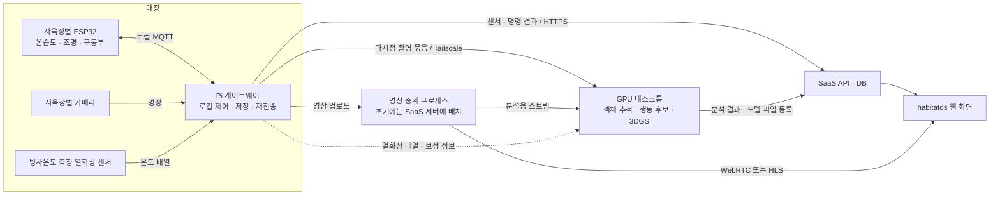

# HabitatOS: 매장 Pi · GPU 데스크톱 · SaaS 연결 설계

> 공개본 안내: 실제 공인 접속 주소·Tailnet 호스트·개인 계정/홈 경로·SSH 키 식별자는 문서용 주소와 자리표시자로 바꾸었습니다. `203.0.113.x`, `gateway.example.ts.net`, `gpu.example.ts.net`, `<gateway-user>`, `<gpu-user>`, `<user>`, `<SSH-KEY-FINGERPRINT>` 등은 실제 접속값이 아닙니다. 명령 실행 전 해당 설치의 확인된 값으로 바꾸세요. 과거 작업 시각·시험 결과·소스 해시는 유지했습니다. `var/reports/`와 과거 첨부 파일 링크는 공개 저장소에 포함되지 않은 운영 근거를 가리킬 수 있습니다.

확정 배포 단위는 **매장당 Raspberry Pi 5 한 대**입니다. SaaS 플랫폼 PC와 GPU PC는
서로 별도 장치입니다. 공통 Pi 프로그램에 매장 ID·인증정보·사육장 구성과 SaaS/GPU 주소를
각각 적용합니다. 센서·영상은 해당 매장의 Pi가 수집하고, 외부 GPU가 복원·분석·예측을
담당하며, SaaS는 매장별 상태와 결과를 관리합니다. 실제 매장 환경·행동 모델의 완성 여부와
배포·연결 검증은 구분합니다. 현재 상태는 아래 2026-10-07 갱신을 우선하며,
과거 배포·정리 이력은 [프로젝트 정리 기록](operations/project-layout.md)에 보존합니다.

## 서비스가 줄이려는 관리 작업

사용자는 사육장마다 온·습도를 확인하고, 얼마나 빨리 건조되는지 살펴보면서 분무 시점과
양을 정해야 한다. HabitatOS의 목표는 이 반복적인 확인과 판단을 줄이는 것이다. 매장 Pi는
여러 사육장의 센서 이력과 장치 상태를 모으고, GPU는 가능한 분무 계획마다 미래 환경을
예측한다. 사용자는 SaaS에서 매장과 사육장을 선택해 현재 상태, 선택한 계획과 그 이유,
주의가 필요한 사육장을 확인한다. 이는 서비스 목표이며 현재 운영 서버에서 모두 제공하는
기능이라는 뜻은 아니다.

제어의 흐름은 **최근 센서·실행 이력 → 후보 분무 계획별 5·10·30·60분 온·습도 예측
→ 환경 이탈과 분무 사용 비용을 비교해 실행 가능한 계획 선택 → 첫 동작 실행
→ 새 센서값과 실행 이력으로 다시 판단**이다. 현재 비용 계산의 분무 사용량은 예상 RUN
시간을 기준으로 하며, 실측 토출량이나 전력 비용을 계산한 결과가 아니다.
여기서 행동 조건부 예측의 ‘행동’은 분무하지 않기, 특정 시점에 정해진 시간만큼 분무하기
등의 장치 동작을 뜻한다. 크레스티드 게코의 행동 분석과는 별도 과제다. 선택한 계획 전체와
실제로 실행한 구간을 남겨야 예측이 맞았는지, 이후 재계획으로 조건이 달라졌는지 구분할 수 있다.
분무량은 실측 유량과 장치 반응을 확보한 뒤 판단하며, REQ 유지 시간이나 예상 RUN을
실제 토출량으로 표시하지 않는다.

3D 화면에서는 센서가 어느 위치를 측정하는지와 그 지점의 미래 예측을 함께 보여준다.
**측정값, 측정 사이의 공간 추정값, 특정 분무 계획에 따른 미래 예측값**은 서로 다른
표시와 시각·조건을 갖는다. 한 지점의 습도만 측정했다면 사육장 전체를 측정한 것처럼
색칠하지 않는다. 사용자가 위치별 차이와 예측의 적용 범위를 보고 확인할 곳을 고를 수 있어야 한다.

서비스 효과는 연결 성공이나 기능 개수로 판단하지 않는다. 같은 목표 환경과 장치 한도에서
사람이 직접 판단하는 운영, 임계값 제어, 예측 제어를 비교하여 다음 항목을 함께 확인한다.

- 사용자가 상태를 확인한 횟수, 분무를 직접 결정·변경한 횟수, 관리에 쓴 시간.
- 온·습도 범위 이탈 시간과 오차, 분무 횟수·실측 토출량, 실패와 개입이 필요했던 이유.
- 5·10·30·60분별 예측 오차와 누락률. 계획을 고정한 예측 평가와 재계획하는 제어 평가를 분리한다.
- 3D에서 측정 위치와 미측정 영역, 예측 시점·조건을 구별할 수 있는지 여부.

현재 합성 비교의 고정 일정 제어는 실제 사용자의 수동 운영을 대신한 결과가 아니다.
사육장 실측과 사용자 작업 기록을 확보하기 전에는 관리 부담 감소나 실물 제어 개선을
완료했다고 판단하지 않는다. 아래의 구현·배포 기록과 이 서비스 효과의 검증은 구분한다.

## 2026-10-07 Pi·GPU 동일 소스와 통합 모의실험

실제 Pi 운영 릴리스는 **`0.4.14-5a9bc13f4f2f`**, GPU API·CUDA worker의 개발 소스는
**0.4.14**다. 공개 소스 151개를 해시 대조하여 두 개발 경로에 적용하고, Pi 설치 코드와
모의실험 코드의 핵심 파일 해시도 대조했다. GPU API 계약 버전 `1.0.0`은 소스 버전과 별개다.
GPU의 기존 설정·인증정보와 환경 모델 파일은 해시가 유지됐으며 새 학습은 수행하지 않았다.

| 확인한 경로 | 결과 | 해석 범위 |
|---|---|---|
| Pi의 제어·시간·환경 계약·SaaS 참고 수신기·패키징·MQTT 검사 | 208개·141개 하위 사례 통과, 33.46초. 환경 API 별도 3개·38개 하위 사례 통과 | 실제 Pi의 프로그램 검사. 실물 센서·ESP·Pico 시험 아님 |
| 신판 ESP32 target build | 센서형·중앙형 모두 통과. 두 설정 모두 출력 0, 업로드 없음, 격리 toolchain 삭제 | 실제 ESP32 도구chain 컴파일. 보드 설치·GPIO 시험 아님 |
| Pi → GPU → 가상 분무 → 다음 센서 입력 | 가상 120분·CUDA 요청 360회, 실제 경과 97.07초. 왕복 중앙값 68.6ms·최댓값 1.93초 | 합성 센서와 미보정 환경 fixture. 실시간 120분 운영·실물 정확도 결과 아님 |
| schema 2 계획·실행 | 360개 응답의 60분 REQ/RUN 계획 대응 확인. 가상 분무 75회, 각 RUN ≤3초, 마지막 펌프 OFF·밸브 없음·idle | 지정 timing fixture의 실행 결과. 아날로그 WINDOW·기동·실제 토출량 보장 아님 |
| 서비스·자료 보존 | Pi health `ok`·MQTT 연결, RTX 4060 CUDA 확인. 출력 잠금 유지, current·previous 두 릴리스 보존 | MQTT 연결은 실물 노드 연결이나 분무 성공을 뜻하지 않음 |
| SaaS | 하트비트 ACK 정상, 대기 이벤트 1개의 sequence·UUID·본문 해시 보존 | 이벤트 연속성 미확인으로 동기화 차단. 서버 마지막 번호를 추정하지 않음 |

계획에 따른 예상 RUN과 이번 가상 실행 RUN의 불일치는 0건이었다. 이는 지정 fixture의
검사이며 실물 시간 일치가 아니다. 원래 선택한 미래 계획을 기록했지만 다음 입력마다
재계획했으므로, 이후 실제 가상 궤적을 원래 예측의 정답으로 채점하지 않았다.
**예측 정확도, 실제 환경 유지 개선, 사용자 관리 부담 감소는 이번 결과로 완료 처리하지 않는다.**

[통합 실행·전체 기록 해시](../var/reports/commissioning/software-r15-20261007-integration.json),
[Pi 설치 코드 대조](../var/reports/commissioning/software-r15-20261007-pi-014.json),
[GPU 서비스·모델 보존](../var/reports/commissioning/software-r15-20261007-gpu-014.json),
[Linux 검사](../var/reports/commissioning/software-r15-20261007-checks.json),
[ESP32 target build](../var/reports/commissioning/esp32-target-build-20261007.json),
[SaaS 상태](../var/reports/commissioning/software-r15-20261007-cloud.json)를 근거로 한다.

## 2026-10-06 배포와 요청 시간 계약 (과거)

당시 Pi에 배포·확인한 릴리스는 **`0.4.13-a1337300e296`**다. 이 배포는 제어 화면의
ON 시간을 펌프 작동 시간이 아닌 **요청 유지 시간**으로 표시한 수정이다. 관련 검사
15개와 subtest 21개가 통과했고, 설치 파일 해시·설정·인증정보·보존 이벤트를 확인했다.
`hardware_outputs_enabled=false`, `r15_bridge.enabled=false`, 실제 분무 관측값 `null`을
유지했다. [Pi 배포 확인](../var/reports/commissioning/software-r15-20261006-request-semantics-deployment.json).
당시 GPU의 마지막 배포 확인은 0.4.12였으며 사용자가 다음 확인을 미뤘다. 당시에는 두
호스트의 동일 버전 배포와 아래 새 계약의 실제 Pi→GPU 실행을 완료하지 않았다.

당시 개발 소스의 버전 문자열도 0.4.13이었지만, 추가한 **schema 2 요청/RUN 분리 계약**은
위 설치 릴리스와 다른 소스 변경이다. 버전 문자열만으로 적용 여부를 판단하지 않는다.
예전 38개 요청 fixture 검사는 당시 소스 해시에 대한 결과이며 새 계약의 검증 기록이 아니다.
[이전 검사 범위](../var/reports/commissioning/software-r15-20261006-request-fixture-check.json).

| 환경 예측 계약 | 미래 계획과 실행 시간의 의미 |
|---|---|
| `schema_version=1`, `timing_mode=desired_run_ideal` | 과거 합성 비교의 가상 RUN 1·2·3초를 직접 적용한다. 기존 수치와 가중치를 보존하며 R15 요청 시간으로 변환하지 않는다. |
| `schema_version=2`, `timing_mode=r15_request_fixture` | REQ 후보 2000·3000·4000·4500·5000ms를 먼저 native-source fixture에 넣고, 예상 RUN 계획을 환경 모델에 입력한다. |

Schema 2의 프로파일은 `r15_esp20_pico_window1ms_phase0_v1`이다. 반환되는
`selected_plan.request_hold_ms`는 60개 정수(0..5000ms, 0은 요청 없음),
`selected_plan.expected_virtual_run_s`는 대응하는 60개 예상 RUN(0..3초)이다.
모든 값의 순방향 시간 대응과 첫 제안의 일치를 검사한다. `misting_proposal.request_hold_ms`는
첫 REQ, `expected_virtual_run_s`와 기존 `pulse_seconds`는 첫 예상 RUN이다. Pi는 REQ를
`duration_s`로 전달하며 예상 RUN을 요청 시간으로 대신 쓰지 않는다. 잘못된 프로파일·혼합된
schema/모드·계획 불일치는 ON 전 거절한다. MQTT/R15 wire 계약 버전은 그대로 유지한다.

이 프로파일은 20ms ESP task의 접수 위상 0과 이상적인 1ms WINDOW 응답을 가정한다.
후보의 예상 RUN은 각각 0.959·1.959·2.959·3·3초다. 실제 가상 실행의 접수 위상은
0..19ms일 수 있으므로 계획의 예상값, 접수 위상에서의 예상값, **실제로 실행한 가상 RUN
구간**을 구분해 기록한다. 다음 분 이력에는 실행 구간만 집계한다. 전체 선택 계획은 보존하되
이후 재계획으로 미래 동작이 달라진 폐루프 결과를 원래 조건부 예측의 정확도 점수로 쓰지 않는다.
이상적인 WINDOW와 가상 시계는 실물 GPIO·보호 회로·분무량 검증을 대신하지 않는다.

새 ESP hello의 `max_request_hold_ms=5000`은 우리 요청 유지 상한이며 원본 Pico의
`run_max_ms=3000`은 유지한다. Pi는 hello에 이 필드가 없으면 3000ms로 보고, 확인한
상한을 넘는 요청은 발행 전에 거절한다. Pi를 먼저 갱신하고 출력 잠금을 유지한 상태에서
ESP/GPU를 같은 검증 소스로 맞춘 뒤 실제 통합 모의실험을 한다. RUN 3초 종료와 REQ LOW는
별개 사건이다. 가상 제어기도 REQ가 HIGH인 동안 RUN을 3초에서 끝내고 DRAIN 1초를 거친다.
새 요청은 REQ LOW 20ms·WINDOW LOW·접수 후 7초 재사용 제한을 모두 충족해야 한다.
TTL 최대 5000ms는 접수 시 신선도 조건이며 REQ/RUN 길이가 아니다. HB 1000ms 보호도
늘리지 않는다. [상세 계약과 검증 범위](protocols/r15-bridge.md).

## 2026-10-05 구현·실행 검증 이력

**실제 Pi·GPU와 소프트웨어 통신은 검증했고, 센서·ESP/Pico·펌프·밸브는 아직 실물로
검증하지 않았다.** 이번 모의실험은 1차 센서 역할과 후속 공용 분무 장치 역할을 가상화한
실험이며 구매 부품 전체의 조립·통전 시험이 아니다. SaaS의 현재 이벤트 동기화에는
해결되지 않은 충돌이 있어 Pi↔GPU 성공과 분리한다.

당시 Pi 릴리스는 **`0.4.12-76a2b5356b9c`**였다. `2026-10-05T13:13:25.834393+00:00`
확인에서 health `ok`·MQTT 연결 `true`였고, 설치 코드 해시가 검증 소스와 일치했다.
설정·인증정보 파일 바이트와 대기 이벤트 1개의 sequence 1·UUID·본문 해시를 보존했다.
`hardware_outputs_enabled=false`, `r15_bridge.enabled=false`이며 실제 분무 관측값은
`null`이다. 하트비트 ACK `2026-10-05T13:13:24.986376+00:00`와 이벤트 연속성 차단은
별개다. GPU도 0.4.12 소스 반영 후 재시작했으며 `2026-10-05T13:13:12.302080+00:00`
확인에서 PID 2854·서비스 active/running·GPU/환경/LiveScene health 모두 HTTP 200이었다.
[Pi 배포 확인](../var/reports/commissioning/software-r15-20261005-active-reservation-deployment.json),
[GPU 재시작 확인](../var/reports/commissioning/software-r15-20261005-active-reservation-gpu.json).

| 항목 | 실행·확인 결과 | 완료로 해석하지 않는 범위 |
|---|---|---|
| Pi 0.4.12 프로그램 검사 | **396 passed, 7 skipped, 231 subtests passed, 108.99초** | 생략된 검사와 실제 장치 시험을 통과로 세지 않음. 새 schema 2 소스 검사 아님 |
| Pi 이전 프로그램 검사 | 0.4.10: 386 passed, 7 skipped, 231 subtests passed, 110.07초 | 당시 기록이며 최신 검사와 합산하지 않음 |
| Pi 카메라 모델명 메타데이터 | 0.4.11의 `0.4.11-7967566bb2ea`에서 최초 적용, 당시 관련 선택검사 11개 통과·0.74초, 0.4.12에서도 설정 유지 | 설정 3개의 예상 모델명을 확인한 결과. USB 실물 자동 식별·촬영 검증 아님 |
| GPU PC의 geometry 검사 | Pi에서 의존성 부재로 생략한 항목을 포함해 기존 복원 환경에서 CPU 회귀 13개 통과 | 실제 사육장 복원 품질이나 CUDA 렌더 성능 검증 아님 |
| ESP32 빌드 | 센서형·N1 중앙 요청형 2역할 대상 빌드 통과, `HABITAT_R15_REQUEST_OUTPUTS=0` 유지 | ESP/Pico 업로드·GPIO·센서·무선 실물 시험 아님 |
| R15 통신·요청 유지 | 자기 예약으로 ON을 취소하던 두 경우를 수정 전 재현; 수정 후 관련 검사 46개·1.29초 통과, 실제 임시 MQTT에서 정상 다음 tick 유지·센서 오류 OFF 확인 | ESP/Pico는 프로토콜 패킷 fixture로 대체; 실물 출력 없음 |
| 환경 예측·가상 제어 | 실제 Pi→GPU CUDA 180요청, 60가상분×3사육장, 실행 45.71263초, 가상 펄스 41회, 종료 시 모두 OFF | 입력 센서와 분무 후 환경 반응은 합성; 물 분사·실측 모델 성능 아님 |
| LiveScene 렌더 | 공개 `interreal-door-original-30000`, 320×237, GPU 17.518초·Pi 전체 왕복 24.594초 | 30,000스텝 공개 문 장면 1회 렌더. Nerfacto 5,000 또는 사용자 사육장 복원 결과 아님 |
| RGB 복원 경로 | 출처 미확인 이미지 38/38장 정렬 → Splatfacto 50회 → 16,920 Gaussian, 4,197,752바이트 PLY, 파이프라인 120.276초 | 새 COLMAP부터 실행한 기능 시험. 50회 학습 품질·최적 스텝·실제 사육장 복원 검증 아님 |
| GPU 작업 API | 0.4.10 최초 활성화, 0.4.12 재시작 후 `backend=splatfacto`, `status=ok`, CUDA·`reconstruction_ready=true` 유지 | 이번 갱신에서 새 학습·렌더 미실시. 신규 LiveScene 학습·사육장 모델 완성과 별개 |
| SaaS | 기존 sequence=1의 서버 충돌 미해결. 연속성 보호로 이벤트 1개를 보존·차단하면서 하트비트 ACK 유지 | 사용자에게 서버 순번/원래 DB가 없어 이벤트 복구 미완료. 신규 R15 서버 배포·저장·화면 연결 미확인 |

환경 요청 왕복 중앙값은 **66.2567ms**, 최대 **2306.795ms**다. 60분은 벽시계 대기가
아닌 각 사육장 가상 시간이며 3D 복원 학습시간이나 영상 FPS와 무관하다. 합성 학습 MLP를
실제 CUDA에서 호출했고, 임계값 fixture를 AI 응답으로 대신하지 않았다. 환경 응답은
`SYNTHETIC_ONLY`, `field_validated=false`, `hardware_execution_allowed=false`를 유지한다.

실행 증거: [Pi 0.4.12 전체 검사 로그](../var/reports/commissioning/software-r15-20261005-0.4.12-tests.log),
[Pi 0.4.10 당시 전체 검사 로그](../var/reports/commissioning/software-r15-20261005-final-tests.log),
[모의실험 JSON](../var/reports/commissioning/software-r15-20261005-simulation/result.json),
[GPU geometry/API 로그](../var/reports/commissioning/software-r15-20261005-gpu-diagnostic-tests.log),
[ESP32 2역할 빌드 JSON](../var/reports/commissioning/esp32-target-build-20261005.json),
[공개 장면 렌더 JSON](../var/reports/commissioning/software-r15-20261005-render.json),
[RGB 복원 경로 시험 JSON](../var/reports/commissioning/software-r15-20261005-reconstruction-smoke.json),
[GPU 0.4.10 활성화 JSON](../var/reports/commissioning/software-r15-20261005-gpu-activation.json).

복원 경로 시험은 기존 보관 이미지 38장의 출처를 확인하지 못한 상태에서 수행했다. 저장된
체크포인트는 `step-000000049.ckpt`이며 50회 제한으로 코드 경로만 확인했다. Backend의
파이프라인 시간은 120.276초, 준비·정리를 포함한 검사 스크립트 전체는 127.758초였다.
원본 이미지·manifest 해시는 보존하고 임시 모델·PLY 등 약 230MB를 삭제했다.
시험 JSON의 `live_backend_name=not_configured`는 운영 설정을 바꾸지 않은 시험 당시 값이다.
이후 별도 활성화에서 `backend.name`만 변경해 현재 `splatfacto` 준비 상태를 확인했다.
기존 모델 해시·작업은 보존됐고 활성화 자체가 학습 작업을 추가 제출하지 않았다.

0.4.10의 worker와 LiveScene 렌더는 같은 `reconstruction.lock`을 공유한다. 잠금 확보 전에
queued 작업을 running으로 바꾸지 않으며, 대기 중 종료와 실행 성공·실패·취소 후 잠금 해제를
검사했다. GPU 작업 API의 준비 상태와 `/v1/livescene/health`의
`rgb_training_configured=false`는 서로 다른 기능을 가리킨다.

### 합성 모델 재평가와 제어 비용

[별도 모델 재평가 JSON](../var/reports/commissioning/software-r15-20261005-model-evaluation.json)은
기존 GPU PC 환경에서 **CPU로 수행한 합성 조건부 평가**다. 위의 실제 Pi→CUDA 60가상분
통신 실험과 별개이며, 가중치·학습 보고서 해시는 전후 동일해 새 학습을 수행한 결과가 아니다.
모델의 3-sensor 구성(SHT 온·습도와 DS 온도 2개 역할), 2,352개 합성 평가창에서 미래 분무 계획을 입력했을 때 습도 MAE는
다음과 같다. 단위는 상대 오차율이 아닌 습도 **퍼센트포인트(%RH 차이)**다.

| 예측 시점 | 5분 | 10분 | 30분 | 60분 |
|---|---:|---:|---:|---:|
| 합성 습도 MAE, pp | 0.2961 | 0.3538 | 0.5834 | 1.0235 |

별도의 폐루프 비교는 가상 360분씩 6회 반복한 평균이다. 아래 화살표는 같은 합성
프로파일에서 **임계값 제어 → 예측 제어**를 뜻한다. `scheduled_proxy`는 고정 일정
비교군이지 실제 사용자의 수동 제어 실험이 아니다.

| 합성 프로파일 | 습도 범위 이탈, 분 | 가상 펌프 ON, 초 | 가정 물 사용량, mL | 온도 범위 이탈, 분 |
|---|---:|---:|---:|---:|
| A | 14 → 3.3333 | 52 → 81.3333 | 41.6 → 65.0667 | 13.5 → 17 |
| B | 62.5 → 13.1667 | 163 → 202.5 | 130.4 → 162 | 21.8333 → 25 |
| C | 156.8333 → 82 | 274 → 331.5 | 219.2 → 265.2 | 35.6667 → 40.5 |

이 설정에서는 예측 제어가 습도 범위 이탈을 줄였지만 **가상 분무 시간·가정 물 사용량이
늘었고 온도 범위 이탈도 증가했다.** 따라서 전 지표 개선·절수·실제 사육환경 우위를
입증한 것으로 발표하지 않는다. 물 사용량은 미보정 `0.8mL/초` 가정으로 계산한 값이며
실측 토출량이 아니다. 위 60분 Pi 모의실험은 물의 양을 계산하지 않아 `water_volume_ml=null`이다.
실제 장치의 유량·환경 반응·종별 목표를 확보한 뒤 이 절충과 모델 오차를 다시 평가해야 한다.

### R15 요청·GPU 운영과 남은 조건

R15는 Pi 명령→인증된 MQTT→N1 디지털 요청의 소프트웨어 경로를 구현했다. 세션·TTL·
중복·재접속·STOP과 공용 자원 예약을 검사하며, 명령 수신과 실행을 구분한다.
`requested`/`execution_unverified`를 실제 작동 성공으로 바꾸지 않고 `actual_state=null`을
유지한다. 기존 Pico BENCH와 Pi/ESP 출력 잠금은 별도로 유지한다.
[프로토콜과 핀 계약](protocols/r15-bridge.md).

0.4.12에서는 정상 ON의 자기 예약을 안전 오류로 취급해 첫 250ms tick에서 OFF를 보내던
오류를 수정했다. 새 ON의 busy/예약 검사는 유지하되 진행 중 요청의 안전 검사와 분리했다.
정상 ON은 유지하고 다른 새 ON은 거절하며, 센서 오류·상태 만료·수위 핀 저하·노드 단절과
STOP 처리는 유지한다. 실제 MQTT 계약시험은 `transport.step()` 다음 `gateway.tick()`에서
정상 요청이 취소되지 않고 센서 오류에는 안전 OFF가 발생하는지 확인했다. 이 결과는 실제
GPIO 신호·펌프 동작을 측정한 결과가 아니다.
[수정 전 2개 실패](../var/reports/commissioning/software-r15-20261005-active-reservation-baseline.log),
[수정 후 관련 46개 통과](../var/reports/commissioning/software-r15-20261005-active-reservation-tests.log).

이때 schema 1의 가상 RUN 후보와 GPU 응답 한도는 **1·2·3초 / 최대 3초**로 맞췄다. 기존 가중치의 입력
정규화 분모 6은 보존했다. ESP `request_hold_ms`, Pico RUN 시간, 실제 토출량은 서로
다른 값이므로 요청시간을 물의 양이나 실제 RUN 측정값으로 사용하지 않는다.
SAFE R15의 약 5초 하드웨어 제한창을 늘리거나 초과 요청을 자동 분할하지 않았다.

GPU 연결의 502는 WSL 종료가 원인이었고 현재 사용자 로그인 예약 작업으로 복구했다.
SSH 종료 이후에도 실제 Pi의 GPU 환경/장면 API와 Pi 장면 중계가 모두 200을 반환했다.
재부팅 후 GPU PC의 `<gpu-user>` 로그인은 필요하며, 절전·로그아웃 중 가용성은 보장하지 않는다.
[GPU 운영 조건](operations/gpu-service.md).

현재 카메라의 판매 UVC·영상 포맷·FPS 표는 확인했다. 남은 문서 조건은 정확한
SMG-A USB-OV5628-A의 OEM AF120 옵션/납품 리비전 대응, 전력·VID/PID·UVC 버전·
초점/노출 제어 정보다. 구매 전선의 품번별 규격, 실제 조립·영상/센서/GPIO/보호·토출
검증, 사육장 실측 학습과 RGB 복원, 크레스티드 게코 행동 모델, SaaS 충돌 해결과 SaaS
수신 계약 배포도 남아 있다. 다른 카메라나 전선의 사양을 구매품에 전용하지 않는다.
[조립 검증·실행 기록](hardware-design/assembly-verification.md).

### 정확한 구매 카메라의 문서 확인 범위 — 2026-10-05

최초 HWP의 카메라는 **SMG-A USB-OV5628-A, 상품번호 15668138**이다.
[판매 상세 본문](https://www.devicemart.co.kr/goods/view_contents?no=15668138&setMode=pc&zoom=1)에서
OV5693·5MP·자동초점·120°·USB 2.0·표준 UVC와 다음 조합을 확인했다.
메인 페이지의 관련자료 0개는 첨부 파일 개수이며, 상세 모드표의 부재를 뜻하지 않는다.

| 해상도 | MJPEG 판매 표기 | YUY2 판매 표기 |
|---|---:|---:|
| 640×480 | 30fps | 30fps |
| 1280×720 | 30fps | 10fps |
| 1920×1080 | 30fps | 5fps |
| 2048×1536 | 30fps | 2fps |
| 2592×1944 | 30fps | 2fps |

구매 SKU의 표준 UVC 지원·위 모드는 판매 문서 근거이며 실물 시험 결과가 아니다.
판매 이미지의 `HBVCAM-5M2134 V11` 실크와 대응하는
[HBVCAM 공식 제품군 페이지](https://www.hbvcamera.com/5megapixel-usb-cameras/usb-camera-module-with-auto-focus.html)는
여러 렌즈 옵션을 소개한다. 상세 표의 고정초점·74°·높이 25mm는 구매 SKU의
자동초점·120°·높이 6.6mm와 다르므로, 그 표의 920mW를 구매품의 최대 전력으로
적용하지 않는다. AF120 옵션의 전원·VID/PID·제어 문서와 실제 USB 모드 열거는 남아 있다.
USB 허브에 3대를 연결했을 때의 FPS·지연·전원 안정성도 이 모드표로 보장하지 않는다.

카메라 예상 모델명 수정은 당시 Pi 릴리스 **`0.4.11-7967566bb2ea`**에 처음 적용했다.
`2026-10-05T12:19:43.090228+00:00` 확인에서 health `ok`·MQTT 연결 `true`였고,
카메라 설정 3개 모두 `expected_model="SMG-A USB-OV5628-A (OV5693, Auto Focus/120deg)"`,
`waiting_usb_port_binding`을 반환했다. 관련 카메라/API 선택검사 11개가 0.74초에
통과했고 예제 설정 검사도 통과했다. 이는 예상 모델명 메타데이터 적용이며, 구매 카메라를
자동 식별하거나 실제 촬영한 결과가 아니다. 0.4.10 전체 검사·GPU 최초 활성화와 이
0.4.11 선택검사는 당시 결과로 보존하고, 이후 0.4.12 검사와 합산하지 않는다.

같은 Pi의 하트비트 ACK는 `2026-10-05T12:19:42.760459+00:00`였고, 보존 이벤트의
sequence 1·UUID·본문 해시는 변하지 않았다. 따라서 연결 유지와 이벤트 충돌 해결은
계속 구분한다. [Pi 카메라 모델명 배포 확인](../var/reports/commissioning/software-r15-20261005-camera-model.json).

## 2026-10-04 실제 확인 범위와 전체 흐름 (과거 기록)

아래의 버전·ACK·시험 횟수·429 결과는 10월 4일 당시 기록이다. 현재 상태는 위의
10월 5일 검증을 따른다. 특히 과거 SaaS ACK 성공을 현재 이벤트 동기화 성공으로 읽지 않는다.

최초 HWP 12품목은 확보했으나 미조립이다. 현재 시험은 **1차 센서 역할과 2차 예정
공용 펌프·밸브의 동작을 가상화한 실제 Pi↔GPU 제어 모의실험**이다.
전체 구매 부품의 회로·통전·유량 시험이나 SaaS·영상·3D를 포함한 종단 시험은 아니다.

| 구성 | 이번 모의실험에서 사용한 것 | 실제 조립·전체 기능 상태 |
|---|---|---|
| 매장 게이트웨이 | 실제 Raspberry Pi 5와 기존 Gateway 코드 | 실제 서비스 active, 0.4.7 |
| 예측 연산 | 실제 GPU API와 합성 학습 MLP, RTX 4060 | 5·10·30·60분 예측 응답 확인; 실측 학습 전 |
| 사육장 센서 3세트 | 세트당 SHT31 1개·DS18B20 2개의 역할을 가상 4채널로 입력 | ESP32 실물·I²C/1-Wire·MQTT 무선 구간은 이번 시험 제외 |
| 분무 | 가상 공용 펌프 1개·밸브 3개, 실행 시간·순서·환경 반응 | 실제 중앙 제어기·드라이버·보호회로·노즐·배관 시험 전 |
| 수위·누수·비상정지 | 별도 fixture 테스트로 정지·복구 규칙 확인 | 실제 스위치·센서·차단회로 시험 전 |
| RGB 카메라·3D | 이번 60분 모의실험에서 사용하지 않음 | 카메라 3개 모두 USB 경로 등록 대기 |
| SaaS | 이번 실험 데이터는 송신하지 않음 | 기존 운영 연결의 ACK는 별도로 정상 확인 |

60분 가속 모의실험의 180회 GPU 응답·31회 가상 분무·41개 별도 제어 검사는
[상세 실행 기록](operations/hardware-arrival.md)에 있다. 물리 부품의 전류·전압·발열·
기동·수압·유량·살수 범위나 온습도 변화량을 검증한 것으로 확대 해석하지 않는다.

### 당시 연결 상태

2026-10-04 18:22 KST에 Pi 운영 API와 GPU API를 직접 조회했다.

- Pi `/health`: HTTP 200, MQTT transport 연결 true, worker_error null,
  `0.4.7-f630b8c2c0bd`. 이는 Pi↔MQTT 연결이며 미조립 ESP32의 센서 수신 증거가 아니다.
- Pi `/v1/cloud`: 최근 성공 ACK `2026-10-04T09:22:47.561701Z`(18:22:47 KST),
  오류 null, 연속 실패 0, 미전송 이벤트 0. 팀원 PC의 SaaS 코드·DB·화면은 이번에
  직접 점검하지 않았다.
- Pi `/v1/environment`: shadow 모드이며 세 사육장 모두 `waiting_sensors`.
  `/v1/cameras`: 세 카메라 모두 `waiting_usb_port_binding`, 검색된 USB 포트 없음.
- 실물 출력 허용 false, 실제 객체↔장치 바인딩 0개.
- GPU LiveScene: 공개 문 모델 `interreal-door-original-30000` 하나만 등록.
  평가 시점 35개, 품질 상태 `experimental_background_motion_unresolved`,
  `rgb_training_configured=false`. 현재 Pi 목록에서 실제 사육장 복원 모델이나
  정적 Nerfacto 5,000 모델을 제공하지 않는다.
- 새 Gaussian 복원 작업 API: `degraded/not_configured`, reconstruction_ready false.
  이는 별도 작업 backend의 상태다. 환경 예측 모델이 CUDA에서 응답하는 상태와 모순되지 않는다.
- Pi→GPU LiveScene 렌더 재요청은 HTTP 429로 거절됐다. GPU의
  `habitat-static-viewer.service`(PID 1909)가 active이며 같은 reconstruction.lock을
  점유한 것을 확인했다. 실행 중인 정적 뷰어를 종료하거나 잠금을 삭제하지 않았다.
  0.0975초의 거절 응답은 3D 렌더 시간으로 집계하지 않는다.

### 데이터와 제어가 이동하는 경로

1. **매장 상태:** 센서 → ESP32 → Pi 수집·검증·SQLite → SaaS
   `POST /v1/edge/sync` → 저장 ACK → Pi 대기열 정리. 현재는 센서 실물 연결 전이며
   기존 상태·연결 유지 경로만 온라인이다. 이 API는 영상이나 새 제어 명령을 받는 API가 아니다.
2. **환경 예측:** Pi의 30분 이력·분무 이력 → 별도 GPU PC → 네 예측 시점과
   분무 제안 → Pi의 검증·제어 판단. 이번 모의실험에서 이 뒤에 가상 펌프와 환경
   재관측을 연결했다. 운영 서비스는 shadow 모드이며 실제 분무를 실행하지 않는다.
3. **기존 3D 모델 보기:** 브라우저 → Pi `/v1/livescene/render` → GPU의 등록 모델
   렌더 → PNG·객체 ID 지도 → Pi 검증 → 브라우저. 현재 공개 문 모델의 등록 시점
   선택 경로다. Nerfacto 5,000의 자유시점 뷰어는 GPU의 별도 네이티브 화면이다.
4. **실제 사육장 새 복원 목표:** RGB 다중 시점 촬영 → 보정·포즈·데이터 준비 → GPU
   학습·평가 → 사육장/복원 버전 등록 → Pi/SaaS 표시. 실제 사육장 입력으로 이 전체
   경로를 완주하지 않았다. 고정 카메라의 같은 시점 영상을 늘리는 것만으로 가려진
   전체 공간 복원 검증을 대신하지 않는다.
5. **SaaS에서 장치 제어 목표:** 사용자 인증·매장 권한 검사 → 해당 Pi로 명령 전달 →
   Pi/중앙 제어기 안전 검사 → 실제 출력·응답 → SaaS 결과 표시. 현재 SaaS→Pi 명령
   수신과 운영 웹의 3D·예측·행동 결과 연결은 완료 확인 전이다. Pi 매장 화면과
   `habitatos.kro.kr`의 SaaS 화면은 별개다.

### 3D 품질과 속도의 의미

| 측정 대상 | 검증된 수치·동작 | 해석 제한 |
|---|---|---|
| 환경 예측 API, 10/04 | 180회 왕복 중앙값 60.297ms, 최대 2.103904초 | 30분 이력이 준비된 뒤의 예측 요청 시간; RGB→3D 시간이 아님 |
| LiveScene 30,000 정지 렌더, 10/03 | 320×237 왕복 23.119초, 서버 작업 16.696초; 상태 0/1은 22.339/20.983초 | 매번 모델을 읽는 요청별 한 장 생성; FPS나 새 장면 학습 시간이 아님 |
| LiveScene 객체 화면, 10/03 | 640×475 두 요청 23.8/22.0초 | 표본 2회, 실시간 서비스 성능 보장 아님 |
| 정적 Nerfacto 5,000, 10/04 | GPU 네이티브 뷰어 회전·이동·확대 및 재렌더 확인 | FPS와 조작→표시 지연 미측정, Pi/SaaS 정적 모델 경로 미연결 |
| 정적 Nerfacto 5,000 품질 | 공개 문 장면 6시점의 배경 평균 PSNR 27.044dB; 원래 LiveScene 19.061dB | 실제 사육장·전체 시점·형상 치수 정확도 판정 아님 |
| RGB 입력→완성 3D | 실제 사육장 종단 시간 미측정 | 촬영·업로드·포즈·학습·등록·표시를 각각 측정해야 함 |

5,000스텝 총 학습시간을 현재 근거로 확정하지 않는다. 다른 모델의 스텝당 시간이나
일시정지가 포함된 실행시간으로 환산하지 않는다. 5,000이 모든 지표의 최적값도 아니다.
후속 공개 장면 비교의 LPIPS는 5,000=0.176149, 10,000=0.170527이고 SSIM 최고는
7,500이었다. 학습 스텝·촬영 위치 추천기와 크레스티드 게코 행동 분류기는 아직 학습 전이다.
온습도 예측 계약에도 전체 3D 좌표별 예측장이 없어 실제 공간 분포로 표시하는 연결이 남아 있다.

품질·렌더 근거와 실행 조건은 [LiveScene 기록](operations/livescene-sample.md),
SaaS 송신 범위는 [동기화 계약](saas-integration.md), 실물 확인 항목은
[조립 검증 기록](hardware-design/assembly-verification.md)을 따른다.

2026-10-04 당시 결론은 **환경 예측·가상 분무 제어의 Pi↔GPU 연결 검증 완료**, **공개 장면 3D
연구·뷰어 동작 확인**, **SaaS 운영 상태 동기화 확인**이다. 실제 사육장 RGB 복원과
SaaS에서 3D·예측·장치 제어까지 이어지는 전체 제품의 완료 선언은 아니다.

## 환경 예측 모델의 다음 실행 계획 — 2026-10-04

아래는 실행 계획이며 실측 학습 완료 기록이 아니다. 핵심 과제는 **분무 계획에 따른
미래 온습도를 학습하고, 그 예측으로 분무 계획을 선택하는 것**이다. GPU가 학습과 추론을
담당하고 Pi는 수집·요청·결과 검증·장치 순서 관리·기록을 담당한다.

### 현재 모델을 기준선으로 유지

실제 코드의 모델은 `210→128→128→240` tanh MLP다. 과거 30분의
`[T1, RH1, T2, T3, 해당 구간의 분무 실행시간]` 150개 값과 후보 미래 60분의
분무 계획 60개 값이 입력이며, 향후 60분×4채널을 예측한다. API는 그중
5·10·30·60분 결과를 전달한다. RGB·3D 형상·종 이름·행동은 현재 모델 입력이 아니다.

현재 후보 시간·펄스 길이와 Plant 계수는 합성 실험 설정이다. 실제 장치의 허용 분무
시간·유량·건조 반응으로 보정하기 전 실물 권장값으로 전용하지 않는다. 운영에서는
여러 실행 가능한 계획을 예측 모델로 비교하고, 선택한 계획의 첫 동작만 실행한 뒤
새 센서값으로 다시 판단한다. 신경망이 환경 변화를 계산하며 목표 범위·평가 비용과
독립 보호 조건은 명시적 설계 기준이다. 이 접근은 신경망 동역학과 MPC를 결합하는
[연구 방향](https://arxiv.org/abs/1708.02596)을 참고하며 해당 연구의 로봇 성능을
사육장 성능으로 사용하지 않는다.

### 순서와 단계별 완료 조건

| 단계 | 수행할 일 | 다음 단계로 넘어갈 근거 |
|---|---|---|
| 1. 실제 입력 기록 | 1차 센서 노드 하나부터 조립·검수하고 시각·센서 ID·위치·품질·배치 버전을 기록. 원본 샘플을 보존하며 기존 분 단위 입력 조건을 확인 | 누락·끊김·재부팅·센서 교체를 구별할 수 있는 실제 로그 |
| 2. 분무 반응 측정 | 추가 분무 장치의 개별 시험 후 동물 없는 사육장에서 분무하지 않은 구간과 검증된 여러 분무 조건을 반복. 노즐별 토출량·지연·습도 상승·건조 반응 기록 | 명령·제어기 실행·실제 토출을 구별하고 반복 조건과 편차가 기록됨 |
| 3. 실측 학습·모델 선택 | 기존 MLP를 실측 데이터로 처음부터 학습한 경우와 합성 사전학습 후 조정한 경우를 비교. 단순 지속값 예측·선형 모델을 기준선으로 사용 | 이후 시간·새 실험 회차·별도 사육장에 대한 5/10/30/60분 오차 표 |
| 4. 출력 없는 실시간 평가 | GPU 모델에 실제 Pi 입력을 보내 예측 시점·모델·분무 조건을 고정 저장하고, 해당 미래 시점의 센서값과 대조 | 일치하는 실행 조건에서 오차·편향·예측구간·응답지연·실패율 확인 |
| 5. 제어 방식 비교 | 빈 사육장에서 사람이 확인·판단하는 운영, 임계값 제어, 예측 제어를 같은 장치 한도와 목표 조건으로 비교. 실측 외란을 기록하고 순서·반복을 통제 | 범위 이탈 시간, 오차, 실제 토출량, 분무 횟수와 함께 확인·수동 개입 횟수, 관리 시간, 실패 사례 비교 |
| 6. 3D·SaaS 표시 | 검증된 센서 위치와 복원 좌표를 대응시켜 현재값·미래값·추정 범위를 표시하고 SaaS 결과 계약을 연결 | 실제 센서 지점·예측 시점·조건·모델 버전·유효기간을 화면에서 구별 |

처음에는 한 사육장의 입력·반응을 확인한 뒤 세 사육장으로 확대한다. 종별 목표 환경은
별도로 확정한다. 수집 일수·필요 표본 수·개선률을 지금 임의로 확정하지 않는다.
서로 다른 초기 습도·건조/젖음 상태·실내 환경·분무 조건이 얼마나 포함됐는지와
검증 오차의 안정성으로 추가 수집 필요성을 판단한다. 관측하지 않은 외기·문 개방·
조명 상태를 학습 입력으로 만들어 넣지 않고, 확인 가능한 항목만 기록한다.

### 평가에서 지킬 조건

- 시간창을 무작위로 나누지 않는다. 실험 회차·사육장·시간순으로 분리하고 과거 입력
  30분과 미래 정답 60분이 경계를 넘나드는 표본을 제거한다. 정규화는 학습 자료에서만
  맞추고 검증 자료로 모델을 선택하며, 최종 시험은 선택에 사용하지 않는다.
  [시간순 다중 시점 평가 근거](https://otexts.com/fpp3/tscv.html).
- 5·10·30·60분의 온도 MAE/RMSE(℃), 습도 MAE/RMSE(%RH의 퍼센트포인트), 편향,
  결과 누락률을 각각 낸다. 센서 오차와 구별할 참조 측정도 필요하다. 허용 오차는
  센서 검수와 목표 제어 여유를 근거로 정하고 최종 시험 전에 고정한다.
- 예측은 특정 미래 분무 계획을 조건으로 한다. 고정 계획을 수행한 빈 사육장의
  예측오차 시험과 매번 재계획하는 제어 성능 시험을 분리한다. 예측 후 실행이 바뀐
  구간은 변경 내역을 기록한다. 사후에 알게 된 미래 실행값을 넣어 얻은 결과는
  사후 조건부 재현 평가이며 당시 가능한 미래 예측 성능으로 발표하지 않는다.
- 예측구간을 제공하려면 별도의 보정 자료와 이후 시험 자료로 실제 포함률과 폭을
  평가한다. 현재 응답에는 학습·보정된 불확실성 구간이 없으며 임의의 ±오차를 붙이지 않는다.
- 자동 재학습 결과를 즉시 운영에 덮어쓰지 않는다. GPU에서 데이터·모델 버전과
  평가 결과를 묶어 보관하고 그림자 예측을 거친 모델을 선택한다. 실측/혼합 학습 모델은
  현재 `SYNTHETIC_ONLY` 계약과 구분해 Pi·GPU 계약 및 회귀검사를 함께 변경한다.
- 명령 시간, 제어기 실행 시간, 실제 물의 양은 다른 값이다. 보정 유량×시간도
  매번 유량계로 측정한 값은 아니므로 추정량으로 표시한다. 공용 펌프의 대기 때문에
  실행이 늦어지면 실제 시작 시각과 최신 센서 조건으로 제안을 다시 검사한다.

### 공간 예측·다른 모델과의 연결

1차 물품 기준으로 한 사육장의 습도 센서는 하나다. 우선 그 측정 지점의 미래 습도를
예측하며, 여러 지점의 습도 분포가 학습된 것처럼 3D 전체에 표시하지 않는다. DS18B20도
실제 부착·삽입 위치를 기록해야 공기/표면 온도라는 의미를 정할 수 있다. 추가 센서를
설치하면 센서 ID·좌표·입력 스키마를 확장하고 다시 학습·검증한다. 센서 수 축소 실험은
제외한 위치에도 독립 참조 센서를 남겨 같은 정답과 비교하며 현재 3/2/1 구성 결과를
8/6/4/2/1 공간 센서 검증으로 표현하지 않는다.

복원 촬영 위치·학습 스텝 추천은 여러 실제 장면의 촬영/학습 결과를 정답으로 모은 후
별도 모델로 학습한다. 크레스티드 게코 행동 분석도 검수한 실제 영상으로 별도 학습한다.
환경 모델에는 이 모델들의 출력이 검증되고 실제 예측 개선이 확인될 때 입력으로 추가한다.
분무만으로 해결할 수 없는 온도 변화는 제어 가능 범위 밖으로 보고하며 불필요한 분무로
보상하도록 목표를 설정하지 않는다.

### 구현한 오프라인 데이터·평가 경로 — 2026-10-04

기존 프로젝트에 [로그 변환기](../habitat/compute/environment_dataset.py),
[예측 평가기](../habitat/compute/environment_evaluation.py),
[실행 명령](../apps/worker/environment_dataset.py)을 추가했다.
**실측 학습·실제 정확도 검증은 조립과 데이터 수집 이후**에 수행한다.
이번 변경은 학습용 자료 생성과 제출된 예측의 점수 계산이며 모델 학습·운영 배포가 아니다.
Pi/GPU/SaaS 서비스, 실행 중인 3D 뷰어와 물리 출력 설정을 변경하지 않았다.

프로젝트 루트에서 사용하는 명령은 다음과 같다. 경로의 입력 파일은 실제 기록을 확인한
후 작성한다. 이 명령이 측정 자료나 예측을 자동으로 만들어 주지는 않는다.

```sh
python -B -m apps.worker.environment_dataset build --manifest var/data/environment-study/manifest.json --output var/data/environment-study/windows.jsonl
python -B -m apps.worker.environment_dataset evaluate --dataset var/data/environment-study/windows.jsonl --predictions var/data/environment-study/predictions.jsonl --split test --output var/data/environment-study/evaluation.json
```

입력 manifest의 형식 예시다. **아래 날짜·ID·DB는 모두 예시이며 실측 자료가 아니다.**
실측을 사용할 때에는 검증된 원본이 `sensor`인지 확인하고 출처를 그에 맞게 설정한다.
출처 문자열을 바꾸는 것만으로 합성 자료가 실측 자료가 되지는 않는다.
`database`는 manifest 기준 상대 경로 또는 실제 원본 DB의 절대 경로다.

```json
{
  "schema_version": 1,
  "data_source": "simulation",
  "site_id": "fixture",
  "gateway_id": "fixture-pi",
  "sensor_ids": ["T1", "RH1", "T2", "T3"],
  "sessions": [{
    "session_id": "test-1",
    "episode_id": "trial-1",
    "database": "gateway.sqlite3",
    "cage_id": "cage-1",
    "split": "test",
    "start": "2026-01-01T00:00:00+00:00",
    "end": "2026-01-01T01:30:00+00:00",
    "geometry_revision": 1,
    "placement_revision": 1,
    "mist_history": "declared_zero",
    "declared_by": "example-operator",
    "coverage_note": "형식 예시: 실제 실험에서는 외부 급수까지 확인한 기록으로 대체"
  }]
}
```

- DB는 `mode=ro`·읽기 트랜잭션으로 접근한다. 운영 `Store`를 생성하거나 Linux 잠금을
  삭제하지 않는다. 새 출력은 덮어쓰지 않고, 실패한 이번 출력만 제거한다.
- 원본 `telemetry`·`audit`·`cloud_identity`를 대조한다. 매장/게이트웨이, 출처,
  시각, 배치 버전이 다르거나 같은 시각의 값이 충돌하면 거절한다. DB identity가 비어
  있으면 manifest 선언만 있다는 사실을 기록하며 자동으로 확인 완료로 바꾸지 않는다.
- `declared_zero`는 **작업자가 확인한 무분무 구간 선언**이다. 빈 audit를 근거로
  자동 선택하지 않는다. ON 관측 또는 실행 이력과 모순되면 실패한다.
  `execution_log`는 완결된 `mist_execution` 구간을 사용하며, 요청 duration이나 ACK를
  실행 이력으로 바꾸지 않는다. `coverage_note`는 누락·수동 급수가 없다는 근거를 기록하는
  필드다. 기록되지 않은 실행까지 코드가 탐지할 수 있는 것은 아니다.
  현재 생산 코드의 이력 생성기는 가상 분무용이므로 실제 제어기의 실행 이력 수집은 남아 있다.
- 기존 분 단위 정렬을 재사용한다. 분 경계 직전 15초 이내의 마지막 유효 관측을 선택하며
  빈 값을 보간하지 않는다. 과거 30개 입력과 미래 60개 관측, 첫 입력의 분무 구간까지
  session 내부에 있어야 한다. 당시 수신되지 않은 센서값이나 미완료/늦게 기록된 과거
  분무가 있으면 해당 창을 제외한다. 제외 사유·개수를 summary에 남긴다.
- 입력은 `[T1, RH1, T2, T3, 실행 초]`, 목표는 매분 4개 센서 관측이다.
  `future_executed_seconds`는 **사후에 알게 된 실제/가상 실행 라벨**이며 당시 알고 있던
  미래 계획으로 취급하지 않는다. 단위는 ℃·%RH·초다. 물의 실측 토출량은 이 자료에 없으며
  `water_volume_measured=false`다. 현재 모델 호환 범위인 분당 실행 6초 초과는 제외하며,
  이를 실제 장치의 권장 설정으로 사용하지 않는다.
- session마다 train/validation/test를 명시한다. 같은 실험 회차를 여러 split에 넣거나,
  같은 사육장의 시간 범위를 복사 DB로 중복 등록하거나, 학습 이후가 아닌 과거 구간을
  test로 뒤집어 지정하면 거절한다. 전체 90분 범위를 경계 안에서 생성하므로 경계를 걸친
  학습창은 생기지 않는다. 정규화는 수행하지 않으며 이후 학습 코드에서 train으로만 맞춘다.
  세 split 중 없는 것이 있으면 `all_splits_present=false`를 기록한다.
- JSONL 하나에 출처 header·시간창·완료 summary를 저장한다. manifest/선택한 원본 행/
  시간창의 SHA-256을 기록하고, 읽을 때 창 ID와 전체 창 해시를 검사한다. 해시는 변경 감지와
  재현용이며 원본 수집의 진실성이나 조작 방지를 증명하는 서명은 아니다.

제출 예측 JSONL은 한 줄에 하나의 객체이며 다음 계약을 따른다.

| 필드 | 의미 |
|---|---|
| `window_id`, `origin_epoch` | 생성된 시간창의 ID와 예측 기준 시각을 그대로 사용 |
| `model_id`, `generated_at_epoch` | 모델 버전과 결과 생성 UTC epoch 초 |
| `prediction_kind` | `prospective` 또는 `retrospective_action_conditioned` |
| `planned_seconds` | 해당 예측에 입력한 미래 60분의 분무 계획, 길이 60 |
| `values` | `{"5": [T1,RH1,T2,T3], "10": [...], "30": [...], "60": [...]}` |

`prospective`는 제출자가 당시 발행했다고 선언한 자료다. 시간은 기준 시각부터 60초
이내인지 검사하지만 **그 값만으로 실제 당시 발행이나 미래 정보 미사용을 증명하지 못한다.**
따라서 보고서는 `declared_prospective_evaluated`·`caller_declared_unverified`로 구분하고
`prospective_evidence=false`를 유지한다. 실시간 증거에는 운영 시점의 변경 이력을 남기는
예측 원장과 모델 학습/선택 이력이 추가로 필요하다. 미래 정답을 보고 만든 결과는 반드시
사후 평가로 분류해야 하며, 실제 GPU 응답을 이 원장/JSONL에 축적하는 연결은 아직 남아 있다.

각 horizon까지의 계획과 실행이 1e-6초 허용오차로 일치하는 창만 조건부 오차를 계산한다.
일치하지 않는 창과 예측 누락은 별도 개수로 남기고, 대상이 전혀 없으면 점수는 null이다.
MAE/RMSE/편향(예측−관측)과 같은 창의 마지막 관측값 유지 기준선(persistence)을 비교한다.
온도는 ℃, 습도는 %RH 퍼센트포인트다. 사후 모델은 미래 실행 조건을 알고 있고 persistence는
그 정보를 사용하지 않는다는 차이가 있다. 보고서 채널 이름은 기존 API 순서인
`air_C, humidity_pct, surface_hot_C, surface_cool_C`이며 실물 위치의 의미는 배치 검수로 확정한다.
현재 점수는 선택 split의 창 단위 집계다. 겹친 창 수는 독립 실험 수가 아니며 여러 사육장/회차의
일반화 판정에는 별도 분리 평가가 필요하다. 선형 기준선·재학습·신뢰구간·제어 개선 판정은 후속 단계다.

검증은 현재 Windows PC에서 합성 SQLite fixture와 제출 예측으로 수행했다.
변환→평가 명령 전체 경로와 오류 처리를 포함해 **25개 unittest가 통과**했다
(데이터 변환 13개, 예측 평가 12개). 원본 DB 불변·출력 덮어쓰기 방지·시간 누출/중첩 차단·분 경계 실행 배분·불완전
산출물 거절을 검사한다. 테스트 파일은 `tests/unit/test_environment_dataset.py`와
`tests/unit/test_environment_evaluation.py`다. Windows에서도 독립 unittest로 실행 가능하며
Linux 운영 잠금을 우회하거나 해제한 것이 아니다. 테스트 산출물은 `var/tmp`에서 정리한다.
실측 성능, 실제 3D 복원 품질, 실물 분무 효과를 이번 fixture 점수로 주장하지 않는다.

```sh
python -B -m unittest discover -s tests/unit -p test_environment_dataset.py -v
python -B -m unittest discover -s tests/unit -p test_environment_evaluation.py -v
```

## 2026-10-03 확정 요구사항과 구현 상태

사용자가 지정한 목표는 아래 세 가지다. 이 절의 목표는 구현 완료 선언이 아니다. 아래쪽의 2026-09-18 설계는 이력이며, 현재 확인 결과는 위 2026-10-07 절을 우선한다. 물품 적용 순서는 최초 HWP와 보유 Raspberry Pi 5가 1단계, 추가 XLSX 물품 확보 후가 2단계다. 카메라 계획은 사육장별 SMG-A USB-OV5628-A 한 대이며, 같은 SKU 판매 문서의 UVC·포맷·FPS는 위 표로 확인했다. 실제 모드·동시 수집과 AF120 옵션 전원·제어는 별도 검증한다. 2026-10-04 사용자 확인 기준으로 물품 확보·미조립 상태다.

### 1. 촬영 시점과 복원 학습량을 예측하는 모델

- **입력:** 촬영 영상, 보정된 카메라 위치·방향, 촬영 시점 간 겹침, 가림·흐림·조명 특성, 복원 설정, 초반 학습의 검증 품질 곡선. RGB 영상만으로 얻은 미확인 자세·깊이를 실측으로 취급하지 않는다.
- **출력:** 추가로 촬영할 위치·방향 후보별 예상 품질 개선, 학습 스텝별 예상 검증 품질과 불확실성, 계산 예산 안의 추천 스텝. 모터 구동 장치는 확인되지 않았으므로 촬영 위치 안내를 목표로 한다.
- **학습:** 같은 복원 방식에서 여러 촬영 묶음·시점 구성·학습 스텝·시드의 실제 결과를 기록한다. 추가 시점의 효과는 그 시점을 포함했을 때의 결과와 포함하지 않았을 때의 결과를 비교하여 학습 자료로 삼는다. 임의의 점수나 고정 threshold로 추천값을 생성하지 않는다.
- **평가:** 촬영 묶음/사육장 단위로 학습·개발·최종 평가를 분리한다. 반복 촬영 프레임이나 동일 실행의 체크포인트가 양쪽에 섞이지 않게 한다. 개발용 검증 영상은 스텝 선택에 사용하고, 최종 평가 영상은 선택에 사용하지 않는다. PSNR·SSIM·LPIPS와 실제 시간·최대 VRAM을 기록하고, 고정 스텝/고정 촬영 방식과 동일 예산에서 비교한다.
- **품질 정의:** 영상의 선명도와 형상의 계측 정확도는 따로 평가한다. 형상 기준값이 없으면 정확한 3D 치수를 복원했다고 주장하지 않는다. 추천은 관측한 후보와 예산 범위에서의 선택이며, 전역 최적 스텝을 보장하지 않는다.

초기 공개 InterReal의 LiveScene 비교 당시 정적 Nerfacto 5,000스텝이 해당 비교군보다 좋은 평균 영상 지표를 보였다. 그 초기 비교는 다른 Nerfacto 스텝까지 탐색한 최적값 판정이 아니며, 이후 스텝별 비교에서는 아래와 같이 지표별 우세 스텝이 달랐다. 실제 사육장에 대한 학습량 예측기는 아직 없다. 학습 곡선 예측은 [LC-PFN 연구](https://arxiv.org/abs/2310.20447)가 참고가 되지만, 해당 연구의 성능을 HabitatOS의 검증 결과로 사용하지 않는다.

후속 실측(2026-10-03): 같은 정적 Nerfacto 실행의 1,000/2,000/3,000/4,000/5,000/7,500/10,000스텝을 기록했다. 개발용 6시점의 평균 LPIPS는 5,000에서 0.176149, 10,000에서 0.170527이었고 평균 SSIM은 7,500에서 가장 높았다. 공통 사진 15장에 후보 한 장을 달리한 네 구성도 같은 초기 가중치와 2,000스텝으로 실행했다. GPU 증거는 `livescene/learning-data-20261003/`에 있으며 체크포인트 11개의 해시를 검증했다. 이는 공개 문 장면 하나의 정답 생성 실험이다. 다양한 장면의 자료가 없어 추천 모델 자체는 아직 학습하지 않았고, 실행 중 일시정지가 포함된 시간 기록은 속도 벤치마크에 쓰지 않는다.

### 2. 5·10·30·60분 후 온도·습도 예측과 공간 표시

- **입력:** 시간과 위치를 기록한 실제 센서 이력, 실제 분무 실행 이력, 확인 가능한 조명·열원 상태, 사육장/센서 배치 버전. 분무 명령과 실제 실행, 센서 측정과 합성 입력을 구분한다.
- **출력:** 네 예측 시점의 온도·습도, 예측 생성 시각, 적용 위치/구역, 예측 조건(예: 추가 분무 없음 또는 명시한 분무 계획), 모델 버전. 예측 구간을 제공할 경우 실제 검증 데이터에서 보정·평가한다.
- **공간 표시:** 정적 복원 좌표와 센서 위치를 보정하여 결합한다. 센서 실측 점, 측정하지 않은 구역의 공간 추정, 미래 예측을 따로 표시한다. 미등록 위치에 임의의 온습도 분포를 채우지 않는다. 공기 온도·표면 온도도 구분한다.
- **제어:** 검증된 행동 조건부 예측으로 후보 분무 계획을 비교하는 방향을 유지한다. 저수위·누수·최대 작동 시간 등의 물리적 보호는 학습 모델과 독립적으로 유지한다.
- **평가:** 시간순으로 학습 이후 구간을 평가하고 사육장·종별 결과를 구분한다. 5/10/30/60분별 오차, 범위 이탈 시간, 분무량과 작동 횟수를 측정한다. 합성 실험 성능과 실물 검증 성능을 혼합하지 않는다.

현재 [환경 예측 클라이언트](../habitat/compute/environment.py)는 30개 분 단위 기록, 네 센서 채널과 분무 실행 시간을 받아 GPU 예측을 요청한다. 응답은 `SYNTHETIC_ONLY`, `field_validated=false`, `hardware_execution_allowed=false`다. 현재 계약에는 3D 좌표별 예측장이 없으므로 기존 결과를 곧바로 전체 공간의 실측 분포처럼 표시할 수 없다. 향후 실측 학습과 위치별 예측 계약을 추가해야 한다.

### 3. 상시 RGB 영상의 개체 추적과 세부 행동 분석

- **영상 수집:** 시각이 보존된 연속 영상/짧은 클립을 GPU 분석에 공급한다. 카메라 장치를 여는 프로세스는 하나로 두고 미리보기와 분석이 입력을 공유하도록 한다. 해상도·FPS·클립 길이·보존량은 실제 UVC 형식, USB 대역폭, Pi 부하를 측정한 뒤 설정하며 현재 성능을 임의로 보장하지 않는다.
- **분석 흐름:** 개체 검출·추적 → 자세/영상 특징의 시간 변화 → 학습된 행동 분류 → 개체별 정상 패턴과 환경·급이·급수 이력을 결합한 상태 추정. 자세 추정만으로 행동이나 질병 분류가 완료됐다고 간주하지 않는다.
- **관찰 행동 후보:** 이동, 오르기, 정지, 은신처 출입, 먹이 섭취, 물/물방울 핥기, 탈피 관련 행동. 종과 촬영 조건에 맞춰 행동 정의와 라벨 기준을 작성하고 실제 영상으로 검증한다.
- **사용자가 요청한 상태:** 수면, 아픔, 배고픔, 목마름은 관찰 행동과 구분해 연구한다. 움직임이 적다고 수면/질병으로, 먹이 쪽으로 이동했다고 배고픔으로, 물을 마셨다고 탈수로 라벨링하지 않는다. 시간대·환경·급이/급수 기록과 검증된 상태 라벨이 필요하고 건강 관련 라벨에는 적절한 임상 근거가 필요하다. 이런 근거가 없으면 상태 판정 대신 관찰 행동과 확인 필요 사항을 반환한다.
- **불확실성:** 가림·화면 밖·저조도·미지원 종은 관측 불가/판단 불가로 남긴다. 마지막 관측 위치를 현재 위치로 표시하지 않는다. 고정 단안 카메라에서 깊이가 확인되지 않은 개체 위치를 정확한 3D 좌표로 표시하지 않는다.
- **학습·평가:** 종·개체·촬영일/연속 영상 구간별로 분리한다. 인접 프레임이 학습과 시험에 섞이지 않게 한다. 행동별 precision/recall/F1, 이벤트 시작·종료 오차, 개체별 시간당 오탐, 관측 가능한 시간 비율을 기록한다. 종 간 전이 성능을 검증하기 전에는 모든 파충류·양서류에 적용 가능하다고 주장하지 않는다. 질병·탈수 상태를 만들기 위한 실험은 수행하지 않는다.

현재 [카메라 구현](../habitat/vision/cameras.py)은 기본 사진 수집에 더해 `record_video=true`일 때 MJPEG 연속 영상을 재인코딩 없이 MKV 클립으로 저장하고 같은 입력에서 미리보기를 만든다. 저장 한도에 도달하면 기존 영상을 보존하고 수집을 중단한다. 구매 SKU의 판매 모드표는 확인했으며 납품 장치의 실제 USB 형식·동시 대역폭은 연결 후 검증해야 한다. 첫 행동 학습 대상은 사용자가 지정한 **크레스티드 게코(Correlophus ciliatus)**다. 학습된 행동 분류기는 아직 없다. [DeepLabCut](https://github.com/DeepLabCut/DeepLabCut)과 [SimBA 연구](https://www.nature.com/articles/s41593-024-01649-9)는 참고 구현이며 파충류 상태 판정이 이미 검증됐다는 의미가 아니다.

### 공통 연결과 검증 상태

Pi 5는 카메라·센서의 시각과 사육장 ID를 보존해 기존 인증된 GPU 경로에 전달한다. GPU는 세 작업의 모델 버전과 입력 출처를 분리하고, 사육장 ID·카메라 ID·센서 배치 버전·복원 버전으로 결과를 연결한다. SaaS 화면에는 정적 구조 위에 환경 예측과 관측된 개체/행동을 겹쳐 표시하는 것을 목표로 한다. 실제 환경 예측·행동 추론의 지연을 측정한 뒤 복원 학습 작업의 실행 시점을 정한다.

| 항목 | 확인된 상태 | 남은 조건 |
|---|---|---|
| 정적 Nerfacto | 공개 예제 7개 스텝·4개 촬영 구성의 품질 기록 완료 | 다양한 사육장 촬영, 시점·학습량 예측 모델 학습/평가, Pi용 정적 모델 호출 연결 |
| Pi↔GPU 복원 | 등록된 공개 예제 LiveScene 모델의 렌더 요청/응답 검증 완료. 별도 일반 RGB 작업 백엔드는 활성화했고, 출처 미확인 보관 이미지 38장의 COLMAP→Splatfacto 소프트웨어 경로 시험 완료 | 구매 카메라의 자동 수집·학습·운영 연계 및 실제 사육장 복원 품질 미검증; 정적 Nerfacto 모델의 운영 연결 |
| 환경 예측 | 실제 Pi↔GPU의 네 예측 시점 응답 및 CUDA 모델 재사용 적용·검증 완료 | 센서/분무 실측, 실측 학습·독립 평가, 3D 위치 결합 |
| 행동 분석 | 연속 영상 저장 코드, 크레스티드 게코 행동 라벨·데이터 분리 검사 구현 | 실제 카메라/영상, 라벨 검수, 학습·독립 평가 |
| SaaS 표시 | 인계용 계약 자료 있음 | 운영 서버에서 세 결과의 수신·저장·화면 연결; 완료 아님 |

GPU API의 실제 기존 범위는 [GPU 연동 계약](gpu/gpu-api-contract.md)을 따른다. 이 설계 추가만으로 API 경로/페이로드를 새로 배포하거나 기존 SaaS `/v1/edge/sync`에 미합의 필드를 전송하지 않는다.

실행 최적화 실측(2026-10-03): 환경 예측 CUDA 모델을 요청 간 재사용하도록 GPU 서비스에 적용했다. 실제 Pi의 전후 9회 합성 입력 시험에서 중앙 응답은 1.415475초→0.057560초, 예측/분무 제안은 동일했다. 공개 예제 LiveScene 렌더 중 9회는 중앙값 0.067904초였다. 첫 요청의 모델 로딩은 남아 있고, 복원 학습·행동 모델을 포함한 세 작업의 동시 운영이나 새로운 예측 정확도를 검증한 결과는 아니다.

다음 구현 순서는 복원 스텝·시점별 실측 품질 기록, 기존 합성 환경 예측의 명시적인 모의 3D 표시, 연속 영상 수집과 행동 라벨링 경로 준비다. 보유 카메라/센서를 조립·연결하면 사육장 보정과 실측 데이터를 확보하여 각 모델을 별도로 학습·검증한다. 현재 데이터로 학습하지 않은 기능을 동작 중으로 표시하거나 검증 전의 정확도·완료 일정을 추정하지 않는다.

## 2026-09-18 초기 설계 이력

작성 기준: 2026-09-18 사용자 요구와 첨부 팀 대화. **시제품은 새 20×20×30 cm 사육장 3개, 사육장별 ESP32와 냉각부, 공용 급수 펌프 1개**로 해석한다. 카메라 모델·배관 유량·냉각 성능은 아직 실물로 검증하지 않았다. 이 문서의 제안은 구매 완료나 팀의 최종 승인 기록이 아니다.

이하의 영상 중계·열화상·여러 Pi 분담은 초기 확장 설계안이다. 현재 확정 배포는
매장당 Pi 5 한 대이며, 실제 구현·접속·검증 상태는 문서 맨 위의 2026-10-06 갱신을 따른다.

## 1. 구성과 책임

가능한 구성이다. 물리적인 컴퓨터는 **매장 Pi, RTX 4060 데스크톱, SaaS 서버**의 세 역할로 시작한다. 한 매장에 Pi 여러 대를 등록할 수 있고, 각 Pi는 담당 사육장 여러 개를 관리한다. 사육장마다 Pi를 둘 필요는 없다.



점선은 추가 구현할 열화상 투영 경로다. 영상 중계는 MediaMTX 같은 **프로그램의 역할**이며, 초기부터 별도 컴퓨터를 한 대 더 산다는 뜻은 아니다. SaaS 서버의 네트워크·프로세스 실행 권한에 따라 GPU 데스크톱에 둘 수도 있다. 그러면 데스크톱이 꺼질 때 영상도 중단되므로 초기 권장 배치는 SaaS 서버다. [브라우저 재생 공식 문서](https://mediamtx.org/docs/read/web-browsers)

| 실행 위치 | 맡는 일 | 중단 시 동작 |
|---|---|---|
| 사육장 ESP32 | 센서 읽기; N1은 선택형 R15 요청 역할, 실제 보호·출력은 Pico/보호회로와 구분 | R15 요청 만료·STOP·끊김 시 LOW 처리 구현·빌드 완료. 실물 GPIO와 보호 타이밍, 별도 냉각·과열 제어는 시험/구현 범위를 따로 확인 |
| 매장 Pi | ESP32 묶음 관리, 제어 정책, 로컬 SQLite, SaaS 전송, 영상 수집/전달 | 인터넷·GPU 장애 중에도 로컬 제어 유지 |
| SaaS 서버 | 사용자·매장·장치 권한, 이력 저장, 웹 API, 화면, 스트림 접근 권한 | 복구 후 Pi 대기열 재수신 |
| GPU 데스크톱 | 영상 추론, 트래킹, 행동 후보, 촬영 묶음에서 3DGS, 열화상 위치 투영 | AI/3D 결과가 오래됐다고 표시; 사육장 제어는 지속 |

`<gpu-user>@100.100.211.20`은 GPU PC의 **SSH 사용자와 Tailscale 주소**다. 이것만으로 영상 수신이나 복원이 시작되지는 않는다. PC에 수신 경로, 작업 큐, 복원 프로그램, 결과 업로드 프로그램이 필요하다. 사용자 브라우저에 이 사설 IP의 파일 경로를 그대로 제공하지 않는다. 웹에서 접근 가능한 인증된 모델 저장소와 영상 URL을 SaaS가 반환해야 한다.

## 2. 매장·Pi·사육장 구분

```text
STORE-001
  PI-001 → CAGE-001 / ESP32-001
           CAGE-002 / ESP32-002
           CAGE-003 / ESP32-003
  PI-002 → CAGE-004 / ESP32-004 ...
STORE-002
  PI-001 → CAGE-001 / ESP32-001 ...
```

SaaS의 장치 키는 `(site_id, gateway_id)`, 사육장 키는 `(site_id, cage_id)`로 둔다. 같은 매장의 사육장은 **동시에 하나의 Pi만 소유**하도록 서버 등록에서 검사한다. 다른 매장의 CAGE-001은 다른 사육장이다. 계정의 tenant/매장 권한은 서버가 인증키에서 결정하며 Pi가 보낸 site_id만 믿지 않는다. Pi 변경 시 담당 매핑과 마지막 이벤트 순서를 명시적으로 이관한다.

온습도 센서 여러 개를 모으는 것과 카메라 여러 개를 인코딩하는 것은 부하가 다르다. Pi 5의 직접 연결 MIPI 카메라 포트는 2개이므로 사육장 3개의 영상을 동시에 보려면 카메라 구성을 따로 정해야 한다. 초기에는 **자체 인코딩이 되는 IP 카메라 또는 확인된 UVC 인코딩 카메라**를 검토하고, 카메라 멀티플렉서는 동시 촬영 여부를 검증한다. [Raspberry Pi 카메라 문서](https://www.raspberrypi.com/documentation/computers/camera_software.html)

용량 산정 예: 카메라당 2 Mbit/s로 실제 설정했을 때 3대는 영상 페이로드 약 6 Mbit/s, 100대는 약 200 Mbit/s다. 이는 설정값으로 계산한 예이며 실제 성능 측정치가 아니다. 프로토콜·재전송 여유와 시청자별 중계 트래픽은 별도다. Pi 한 대의 사육장 수를 미리 단정하지 않고 CPU 온도, 인코딩 부하, USB 대역폭, Wi-Fi, 업링크를 측정하여 Pi를 나눈다. 카메라를 여는 프로세스는 하나로 두고 중계 스트림을 웹·AI에 분배한다.

## 3. 데이터별 연결 방법

| 데이터 | 경로와 제안 주기 | 웹 표시 |
|---|---|---|
| 온습도·조명·급수 출력 | ESP32 → Pi MQTT, Pi → SaaS HTTPS 묶음 전송; 현재 SaaS 전송 기본 5초 | 값, 단위, 측정 시각, 품질, 시뮬레이션 여부 |
| 명령 결과 | Pi의 publishing/published/applied/rejected/expired 등 상태 변경을 이벤트로 전송 | 요청·전송·장치 ACK를 구분 |
| 영상 | Pi/카메라 → 중계 → 웹 WebRTC/HLS | 실시간 영상, 마지막 프레임 시각, 연결 끊김 |
| 객체·행동 후보 | 중계 → GPU 추론 → SaaS 이벤트 | 관측됨/가려짐/미검출, 궤적, 행동 후보와 신뢰도 |
| 3DGS | Pi의 별도 다시점 촬영 → GPU 일괄 복원 → 모델 저장소 → 웹 | 모델 버전, 생성 시각, 복원 실패/진행률 |
| 표면 온도 | 열화상 온도 배열 + 시간/카메라 보정 → GPU 투영 → SaaS/웹 | 관측된 표면만 색으로 표시 |
| 공간 공기 온도 | 위치를 아는 여러 접촉식 온도센서 → 보간 모듈 → 웹 | 실측 점과 **추정 영역**을 구분 |

MQTT에는 영상 파일을 넣지 않는다. JSON 센서 전송과 영상·촬영 묶음은 별도 연결을 사용한다. 영상의 수 초 이내 지연이나 목표 FPS는 아직 측정한 보장치가 아니다.

웹에 `급수 출력 ON`이 표시돼도 막힌 호스까지 확인한 것은 아니다. 현재 구상에는 유량 센서가 없으므로 `실제 물 토출 확인됨`으로 표시하면 안 된다. 일반 장치의 `applied` 역시 노드가 출력 적용을 응답했다는 뜻이다. R15 요청 브리지는 이 응답을 만들지 않고 `requested`/`execution_unverified`, `actual_state=null`을 유지한다.

현재 추가한 Pi 전송 기능과 SaaS 수신 형식은 [연동 규격](saas-integration.md)에 있다. SaaS에서 내리는 원격 명령 수신은 이번 구현에 포함되지 않는다. 추후 추가할 때는 `request_id`, 기한, 사육장 소유권을 검사하고 기존 로컬 제어 검사를 통과시켜야 한다.

## 4. 객체 탐지와 행동 분석

객체 탐지로 도마뱀 위치와 신뢰도를 얻고, 연속 프레임 추적으로 이동량·영역 체류·가시 시간을 계산한다. 첫 단계의 결과는 `이동 중`, `관측상 정지`, `가림/미검출` 정도로 제한하는 것이 검증하기 쉽다. 사육장 ID와 개체 ID는 별도로 보관한다. 여러 마리가 있으면 추적 ID가 재배정될 수 있으므로 개체 식별 정확도도 별도 평가한다.

`먹는 중`, `잠자는 중`, `탈피`, `이상 행동`은 해당 장면에 라벨을 붙인 학습/검증 데이터가 필요하다. 안 보이는 상태를 사망·탈출로, 움직임이 적은 상태를 질병으로 단정하지 않는다. 행동 모델 버전, 관측 시간 구간, 신뢰도, 근거 영상 시각을 함께 반환한다. [영상 분석 모델 학습·평가 참고](https://deeplabcut.github.io/DeepLabCut/docs/beginner-guides/video-analysis.html)

GPU 처리 우선순위는 제안상 실시간 추론 → 열화상 투영 → 3DGS 일괄 복원이다. 4060 한 장에서 모두 동시에 실행할 수 있다고 가정하지 않고, VRAM/프레임 지연을 측정해 3DGS를 예약 실행한다.

## 5. 3DGS와 온도 표시가 성립하는 조건

### 정적인 내부 구조를 먼저 복원

고정 카메라 한 대에서 오래 찍은 영상은 새로운 시점을 만들어 주지 않는다. 설치할 때 카메라 위치를 바꾸어 겹치는 여러 시점으로 내부 구조를 촬영하고, 구도·초점·조명을 관리한다. 유리 반사, 물방울, 움직이는 동물은 재구성에 방해가 된다. 동물이 없는 설치 단계에서 구조를 촬영하는 방식을 우선 검토한다. [COLMAP 촬영 지침](https://colmap.github.io/tutorial.html)

촬영/작업 인터페이스는 [GPU 계약 v1.0.0](gpu/gpu-api-contract.md)으로 정리했다. `CaptureManifest`는 capture_id, 매장/Pi/cage, geometry/placement revision, 촬영 시각, files의 UUID·이름·크기·해시를 담는다. JobRequest는 별도 job_id와 capture_id를 참조한다. Pi 0.3.0의 별도 worker가 등록·업로드·작업 조회·결과 다운로드를 구현한다. [실행 방법](operations/compute-client.md)

서버 status는 `queued/running/succeeded/failed/interrupted`, stage는 `queued/colmap/training/exporting/complete/failed/interrupted`다. 모든 파일의 검증·영속 저장 뒤에만 학습을 요청한다. 초기 계약은 실측 스케일 보정을 포함하지 않아 `metric_scale_verified=false`다. 실제 크기/좌표 변환과 열화상 등록은 후속 보정 계약에서 검증해야 한다.

Nerfstudio는 기본 Splatfacto에 대략 6 GB 메모리를 안내한다. 이는 작은 장면을 시험할 출발점이며, 이미지 수·해상도·Gaussian 수에 따라 4060에서 메모리가 부족할 수 있다. 현재 PC 접속·VRAM·처리 시간을 검증하지 못했으므로 복원 속도를 약속하지 않는다. [Splatfacto 공식 문서](https://docs.nerf.studio/nerfology/methods/splat.html)

### 적외선 야간 영상과 온도 측정은 다른 입력

Pi NoIR 카메라는 IR 차단 필터가 없는 영상 카메라다. 픽셀에서 섭씨 온도가 나오는 열화상 장치가 아니다. 일반 카메라는 객체 탐지용, **방사온도 값을 제공하는 열화상 센서**는 표면 온도용으로 분리한다. MLX90640은 예를 들면 32×24 온도 배열 장치이며 영상 카메라와 동일한 해상도를 기대할 수 없다. 이 예시는 최종 구매 지정이 아니다. [Pi Camera Module 3](https://www.raspberrypi.com/products/camera-module-3/), [Melexis MLX90640](https://www.melexis.com/en/product/MLX90640/Far-Infrared-Thermal-Sensor-Array)

열화상은 보통 **보이는 표면 온도**를 측정한다. 공기 전체의 3차원 온도를 직접 측정하지 않으며 일반 유리를 통과해 내부를 측정하는 배치를 가정해서도 안 된다. [FLIR 표면 온도 설명](https://www.flir.com/discover/instruments/firefighting/high-temp-ranges-tics/), [FLIR 유리 투과 설명](https://www.flir.ca/discover/cores-components/can-thermal-imaging-see-through-walls/)

표면 투영을 위해 필요한 데이터:

- 열화상 카메라 내부 파라미터·왜곡, 사육장 좌표계에서의 외부 자세, 보정 버전.
- RGB/열화상 시각 동기화, 촬영 시각, 픽셀별 온도와 유효 마스크, 방사율 등 교정 설정.
- 미터 단위 사육장 좌표계와 3DGS 좌표의 변환, 열화상 광선이 만나는 표면을 판정할 깊이/보조 형상.
- 가려짐·모델 깊이 오차·센서 해상도의 검증. 3DGS 자체가 정확한 계측용 표면을 보장하지 않는다.

웹은 **① 3DGS 외형, ② 열화상으로 관측한 표면 온도, ③ 위치를 아는 T1–T5 등의 공기 온도와 보간 추정치**를 별도 레이어로 제공한다. 보간하지 못하는 영역은 미측정으로 남긴다. 카메라·장식물 위치를 바꾸면 revision을 갱신하고 재보정한다. 센서가 끊기면 마지막 값을 실시간 값처럼 계속 색칠하지 않는다.

따라서 목표는 **처음 만든 3D 사육장 위에 최신 측정값을 갱신하는 화면**이다. 움직이는 도마뱀 전체를 매 프레임 3DGS로 재구성하거나 사육장 공기 온도를 완전 실측하는 기능은 별도의 연구 과제다.

## 6. 세 사육장의 급수·냉각과 제어 모델

첨부 대화는 고압 미스트 대신 **수중 펌프로 물을 올려 후면 벽을 따라 흐르게 하는 급수**로 바뀌었다. 분무 노즐로 물방울을 안개처럼 뿌리는 기능과 구분해야 한다. 수중 펌프의 정격 전압·양정·설치 높이에서의 유량을 확인하기 전에는 미스트가 된다고 말할 수 없다.

공용 탱크 → 펌프 → 3분기 매니폴드 → 각 사육장 상단 분배부로 연결한다. 배관 길이·높이를 비슷하게 맞추고 조절부로 실제 토출량을 측정한다. 세 갈래로 나눈 사실만으로 1/3씩 흐르지는 않는다. 호스 구멍을 뚫는 방식도 실측 없이 균일 급수를 보장하지 않는다.

| 선택 | 추가 구동부 | SaaS에 표시할 제어 단위 |
|---|---|---|
| 3개 동시 급수 | 공용 펌프 1개 | 급수 그룹 하나, 영향을 받는 사육장 3개 |
| 사육장별 급수 | 공용 펌프 + 분기별 밸브와 드라이버; 펌프가 닫힌 배관에서 동작하지 않도록 순서/보호 설계 | 공용 펌프 상태와 사육장별 밸브 상태 |

초기 코드의 `mister`는 독립 사육장 출력 예제였다. **공용 펌프를 세 사육장의 독립 mister로 복제하여 연결하면 안 된다.** 현재는 공용 펌프·3밸브의 가상 순서 관리와 R15 명시적 zone/사육장/actuator 매핑·공용 예약을 구현했다. 매핑과 물리 출력 잠금은 자동 해제하지 않으며 실제 펌프·밸브 운전 검증은 남아 있다.

사용자 요구대로 사육장 누수·바닥 수위 센서는 제외한다. 공용 물통에는 부족/보충 알림과 펌프 정지용 수위 입력이 필요하다. 한 임계점 센서이면 부족과 정지가 같은 조건이 되고, 미리 경고하려면 별도 임계점이 필요하다. 펌프 MCU에도 저수위 차단을 구현한다. 사육장별 받침·배수와 펠티어 응축수 경로는 센서 없이도 설계한다. 사용한 사육장 배수를 공용 급수통으로 되돌리는 구성은 채택하지 않는다.

사육장별 펠티어는 차가운 면만 사육장 쪽 열교환부에 연결하고 뜨거운 면의 **이동한 열 + 소비 전력**을 사육장 밖으로 버려야 한다. 펠티어 판만 천장에 붙이는 것으로는 완성되지 않는다. 방열판·팬·온도 제한·응축수 배출·단열·탈착 보호망이 필요하다. 저전압 구동부와 Pi 전원을 분리하며, 극성을 바꾸어 난방까지 할지는 드라이버 정격·결로·과열 시험 뒤 결정한다. 기존 [1개 사육장 열설계 초안](hardware-design/20x20x30-design.md)은 계산 가정이며, 최종 3개 배치/새 급수 방식과 일치하도록 다음 설계에서 갱신해야 한다.

## 7. 구현 상태와 다음 연결 조건

| 항목 | 현재 상태 |
|---|---|
| 여러 사육장 등록, 로컬 센서/명령 처리, MQTT 전송 계층 | Pi 검사·실제 MQTT 루프백 및 ESP32 2역할 대상 빌드 통과. 실물 ESP/Pico 시험 전 |
| Pi → SaaS 센서·명령 이벤트, 현재 상태 전송 | 송신·재시도·재시작 보존 구현. 기존 sequence=1의 서버 충돌은 미해결; 연속성 보호로 이벤트 1개를 보존·차단하면서 하트비트 ACK 유지 |
| habitatos 서버의 신규 R15 수신/화면 연결 | 계약 인계 자료 있음. 운영 서버에 신규 상태·메타데이터가 배포됐는지는 미확인 |
| Pi → GPU 요청·결과 검증 | 실제 CUDA 환경 예측 180회 및 공개 LiveScene 렌더 성공. 실제 RGB 신규 복원 전체 경로와 구분 |
| 카메라 중계·행동·실제 사육장 3D 복원 | 입력/저장 코드와 연구 모델은 있음. 구매 카메라 실수집·사육장 복원·행동 학습/평가 미완료 |
| 열화상 교정·3D 표면 투영·공기 온도 보간 | 설계 단계; 측정 실험 필요 |
| 공용 급수·냉각·조명 실물 구동 | R15 분무 요청 브리지·공용 예약 구현 완료. 실제 급수/보호 시험과 별도 냉각·조명 기능은 완료로 세지 않음 |

초기 공개 화면의 데모 데이터·HTTPS/SSH 실패 기록은 당시 상태이며 현재 접속 결과가 아니다. 2026-10-05에는 실제 Pi→GPU HTTPS·CUDA 예측·공개 장면 렌더를 확인했다. SaaS는 빈 하트비트의 HTTPS 성공과 기존 이벤트의 409 충돌을 각각 확인했고, 팀원 서버의 새 R15 코드·DB·화면 배포는 직접 검증하지 않았다.

연결 순서는 **사육장 1개 센서 → SaaS 실제 값 → 3개 등록 → 1개 영상 → 객체 추적 → 초기 3DGS → 열화상 보정/온도 레이어**로 제안한다. 단계마다 원시 데이터와 시각을 보존하고 실물 결과로 통과 여부를 판단한다. 세 사육장의 웹 화면이 필요하다면 서버 저장소에서 데모 데이터를 실제 조회 API로 바꾸는 작업이 이어져야 한다.
